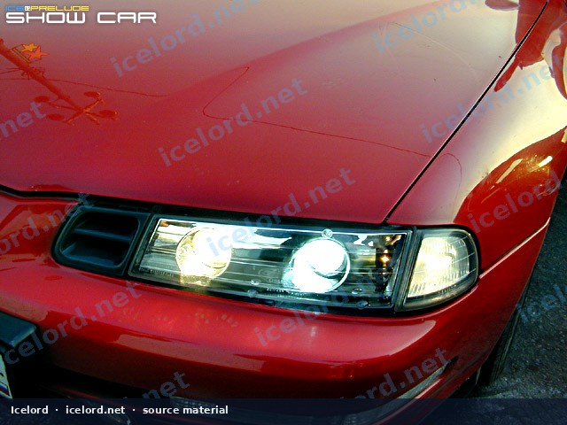
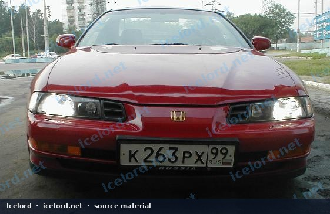
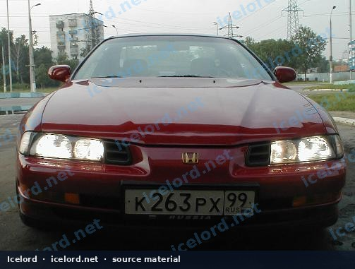
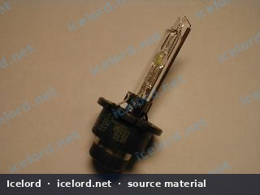
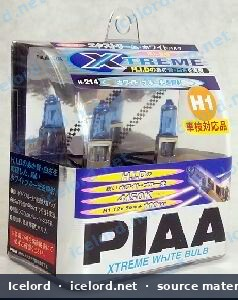
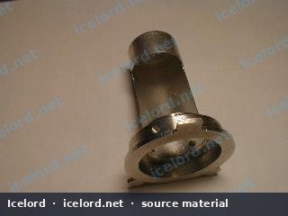
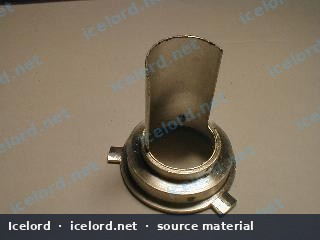
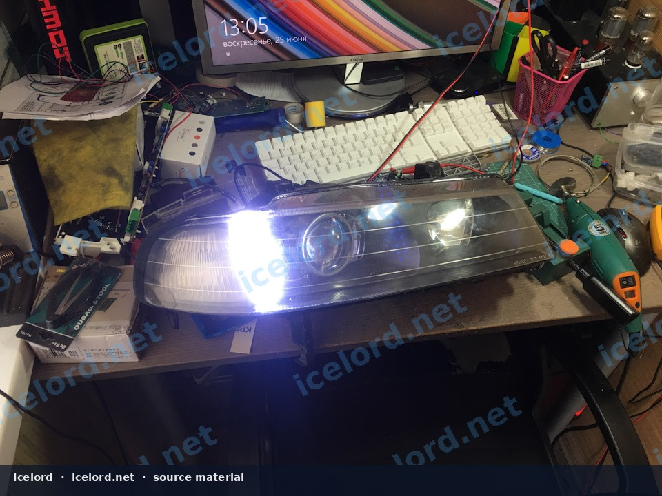
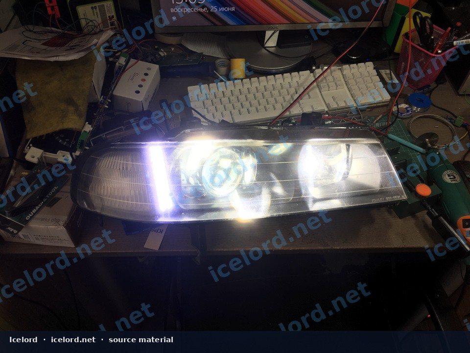
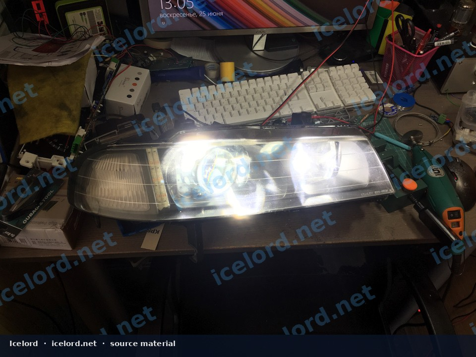

# Fourth-Generation Prelude Projector Headlamp Retrofit and Beam Verification

Projector retrofits only improve night vision when the cutoff is sharp, aim is legal, and glare is controlled. A bright, uncontrolled lamp is worse than stock halogen.

```carousel

<!-- slide -->

<!-- slide -->

<!-- slide -->

<!-- slide -->

<!-- slide -->

<!-- slide -->

<!-- slide -->


```

```carousel

<!-- slide -->


```

## Applicability

- Fourth-generation Prelude (BB) housings
- HID or LED projectors with matching drivers/ballasts

## Mechanical Requirements

- Rigid projector bracket referenced to the original aiming plane
- Correct LHD/RHD shield orientation
- Fully resealed housing (dust and moisture kill projectors)
- No lens contact with the projector under thermal expansion

## Process Outline

1. Remove and open the headlamp (or install a quality complete assembly).
2. Mount projectors; mock up cutoff on a wall before final seal.
3. Seal with proper butyl/OEM-style sealant; check for fogging later.
4. Wire via relays and fuses sized for ballast inrush - do not overload the stalk switch.
5. Set aim at the correct distance and height for local inspection rules.

## Beam Checks

| Check | Pass |
| :--- | :--- |
| Low-beam cutoff | Clean horizontal line, correct step side |
| Glare | No significant light into oncoming eyes |
| High beam | Usable center without random scatter |
| Stability | Pattern does not shift after bumps |

> [!WARNING]
> Misaimed projectors blind other drivers. Re-aim after any front-end work or reseal.

## Legal

Follow local regulations. Decorative halo/demon-eye lighting is not a substitute for a compliant low beam.
