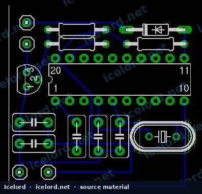

# JDM Honda/Acura 180 km/h Speed Limiter VSS Signal Conditioner

JDM (Japanese Domestic Market) Honda and Acura vehicles are typically equipped with an electronic speed limiter, restricting the vehicle's maximum speed to approximately 180 km/h (112 mph). This limitation is enforced by the Engine Control Unit (ECU) based on the Vehicle Speed Sensor (VSS) signal. A VSS signal conditioner, often referred to as a "speed limiter defencer," is an electronic module designed to modify this signal, allowing the vehicle to exceed the factory-imposed speed limit.

*Image placeholder - replace with a publication-cleared photo (vss.png).*

## Theory of Operation

The VSS signal conditioner operates by intercepting the raw VSS signal from the transmission and conditioning it before it reaches the ECU. The VSS generates a square wave signal with a 50% duty cycle, where the frequency directly corresponds to vehicle speed.

The device continuously monitors the incoming VSS frequency. When the vehicle speed is below a certain threshold (approximately 170 km/h or 119 Hz), the conditioner acts as a pass-through, transmitting the authentic VSS signal directly to the ECU. Once the actual vehicle speed exceeds this threshold, the module switches to a "virtual mode." In this mode, it generates and outputs a simulated VSS signal to the ECU, typically capped at a frequency equivalent to the threshold speed (e.g., 119 Hz). This tricks the ECU into believing the vehicle is still operating below the 180 km/h limit, preventing fuel cut-off or other limiter-induced interventions.

### Vehicle Speed Sensor (VSS) Signal Characteristics

The VSS signal frequency scales linearly with vehicle speed. The following are approximate frequencies for common speeds:

| Speed (km/h) | Speed (mph) | VSS Frequency (Hz) | Duty Cycle |
| :----------- | :---------- | :----------------- | :--------- |
| 60 | 37 | 42 | 50% |
| 100 | 62 | 70 | 50% |
| 120 | 75 | 84 | 50% |
| 170 | 106 | 119 | 50% |

> [!NOTE]
> These values are typical for many Honda/Acura VSS systems. Always confirm specific VSS characteristics for your vehicle model and year using the factory service manual.

## Installation Principles

Installing a VSS signal conditioner involves integrating the module into the vehicle's existing VSS wiring harness. The device typically requires connections for input, output, power, and ground.

### Required Connections

* **VSS Input:** Connects to the original VSS signal wire coming from the transmission.
* **VSS Output:** Connects to the VSS signal wire leading to the ECU.
* **Power (12V):** Connects to a switched 12-volt power source.
* **Ground:** Connects to a reliable chassis ground point.

> [!IMPORTANT]
> The specific VSS wire color, pin location at the ECU, and optimal installation point vary significantly between Honda/Acura models and generations. **Always consult the factory service manual (FSM) for your exact vehicle to identify the correct VSS wire.** Incorrect wiring can lead to ECU damage or vehicle malfunction.

### General Installation Steps

1. **Locate the VSS Wire:** Identify the VSS signal wire leading to the ECU. This is often found at the ECU connector itself or within the engine bay harness.
2. **Cut the VSS Wire:** Carefully cut the VSS signal wire at a suitable location.
3. **Wire the Conditioner:**
* Connect the VSS wire coming *from the transmission* to the conditioner's VSS input.
* Connect the VSS wire going *to the ECU* to the conditioner's VSS output.
* Connect the conditioner's power wire to a switched 12V source.
* Connect the conditioner's ground wire to a chassis ground.
4. **Secure the Module:** Mount the signal conditioner securely in a location protected from moisture and excessive heat.
5. **Test Functionality:** After installation, test the vehicle's speedometer and ensure proper operation at all speeds, including above the original limiter threshold.

> [!CAUTION]
> Improper wiring can cause damage to the ECU, the VSS, or the signal conditioner itself. Ensure all connections are secure, insulated, and correctly oriented.

## Internal Components

While specific designs may vary, these devices commonly utilize a microcontroller, such as the Atmel AT89C4051, to process and condition the VSS signal. The microcontroller's firmware is programmed to implement the logic for real signal pass-through and virtual signal generation based on the input frequency.

> [!NOTE]
> This article describes the general principles of a common JDM speed limiter defencer. Specific implementations may differ. For detailed schematics or programming information, refer to the manufacturer's documentation for your specific device.
