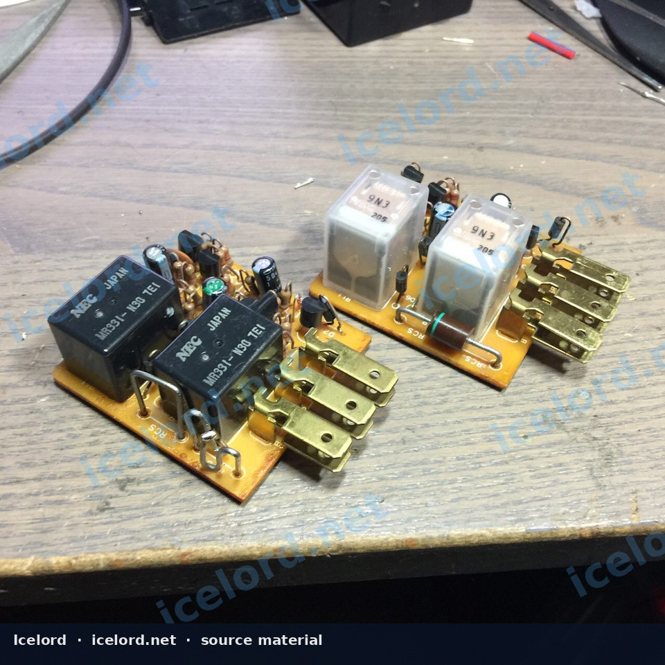

# Honda Turn-Signal Flasher Modification for LED Bulbs

## Understanding LED Turn Signal Issues
When incandescent turn signal bulbs are replaced with Light Emitting Diode (LED) equivalents, a common issue known as "hyper-flash" often occurs. This happens because LED bulbs draw significantly less current than traditional incandescent bulbs. The vehicle's flasher relay is designed to detect a specific current draw, and if the draw is too low (as with LEDs), it interprets this as a burnt-out bulb and rapidly increases the flash rate to alert the driver.

Traditional solutions involve installing load resistors in parallel with each LED bulb. While effective, load resistors generate heat, consume power, and add complexity to the wiring. Modifying the flasher relay directly offers a cleaner solution by adjusting the relay's internal logic to correctly interpret the lower current draw of LED bulbs.

*Image placeholder - replace with a publication-cleared photo (f0267f9s-960.jpg).*

## Required Tools and Components
To perform this modification, gather the following items:

* Small flathead screwdriver or plastic pry tool (for opening the relay casing)
* Soldering iron and fine-gauge solder
* Wire cutters/strippers (if needed for internal wiring)
* Heat shrink tubing or electrical tape (for insulation)
* **Rectifier Diode:** A suitable rectifier diode. The original source suggests a КД226В diode. When selecting a modern equivalent, ensure it has appropriate voltage and current ratings for automotive use. Confirm the diode's specifications against the factory service manual for the specific relay circuit.

> [!IMPORTANT]
> Ensure the rectifier diode's polarity is correctly identified before installation. Diodes typically have a stripe indicating the cathode (negative) side.

## Flasher Relay Identification and Removal

1. **Locate the Flasher Relay:** The turn signal flasher relay is typically found in the under-dash fuse box or mounted to the vehicle's chassis behind the dashboard. Consult your vehicle's factory service manual for the exact location.
2. **Identify the Relay:** The flasher relay is usually a small, cube-shaped component with 2 to 4 pins. It will often have a distinct clicking sound when the turn signals are active. You may need to activate the turn signals or hazard lights to help pinpoint its location by sound.
3. **Remove the Relay:** Disconnect the vehicle's battery before proceeding. Carefully pull the relay straight out from its socket. Some relays may have a retaining clip that needs to be released first.

## Modifying the Flasher Relay

> [!WARNING]
> This procedure involves working with sensitive electronic components. Incorrect modification can damage the relay or the vehicle's electrical system. Proceed with caution and ensure you have adequate soldering skills.

1. **Open the Relay Casing:** Carefully use a small flathead screwdriver or pry tool to separate the plastic casing of the flasher relay. Take care not to damage the internal circuit board.
2. **Identify the Modification Point:** Inside the relay, locate the printed circuit board (PCB). The modification involves integrating a rectifier diode into the internal circuit responsible for sensing the load or controlling the flash timing. Without a specific schematic for every relay variant, careful inspection of the PCB is necessary to identify the current-sensing path or the timing capacitor/resistor network. The goal is to alter how the relay detects the current draw.
3. **Integrate the Diode:** The source suggests adding a rectifier diode. This typically involves soldering the diode in a specific orientation within the circuit. For example, it might be placed in series with a sensing resistor or across a timing component to adjust the circuit's response to lower current. The cathode (stripe side) of the diode must be oriented correctly according to the intended current flow. If the exact placement is unclear, it is crucial to consult a detailed schematic for the specific flasher relay or seek expert guidance.
4. **Insulate and Reassemble:** Once the diode is securely soldered, ensure all exposed leads are properly insulated with heat shrink tubing or electrical tape to prevent short circuits. Carefully reassemble the relay casing, ensuring it snaps back together securely.

## Testing and Verification

1. **Reinstall the Relay:** Plug the modified flasher relay back into its socket in the vehicle.
2. **Reconnect Battery:** Reconnect the vehicle's battery terminals.
3. **Test Turn Signals:** Activate both the left and right turn signals, as well as the hazard lights. Observe the flash rate. The signals should now flash at a normal, consistent rate without hyper-flashing.

> [!TIP]
> If the issue persists or new problems arise, immediately disconnect the battery and re-inspect your work. Ensure the diode is correctly oriented and all solder joints are solid.

## Important Considerations

* **Diode Specifications:** Always confirm the voltage and current ratings of the chosen rectifier diode are appropriate for the application. Using an under-rated diode can lead to premature failure.
* **Relay Specifics:** Internal relay designs can vary significantly between models and manufacturers. What works for one relay may not be directly applicable to another. Always inspect your specific relay's PCB carefully.
* **Factory Service Manual:** For precise circuit diagrams and component identification, refer to the factory service manual for your specific vehicle and flasher relay.

> [!CAUTION]
> Improper soldering or incorrect diode placement can permanently damage the flasher relay or other vehicle electronics. If you are not confident in your soldering or electrical diagnostic skills, it is recommended to consult a professional or consider an aftermarket LED-compatible flasher relay.
