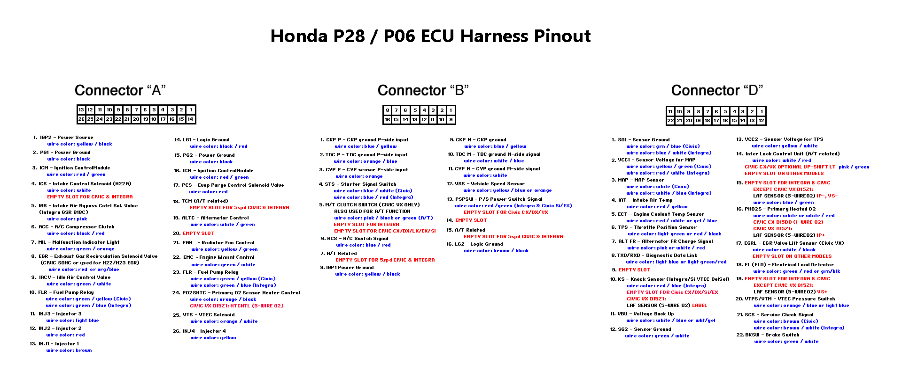
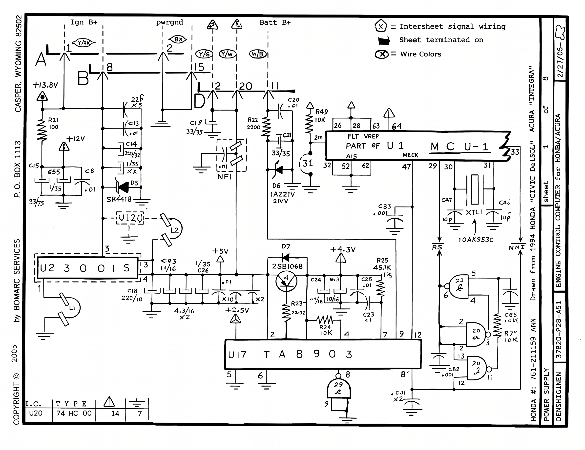
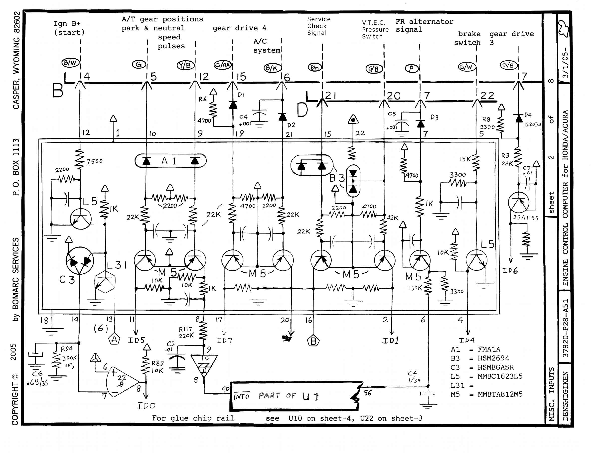
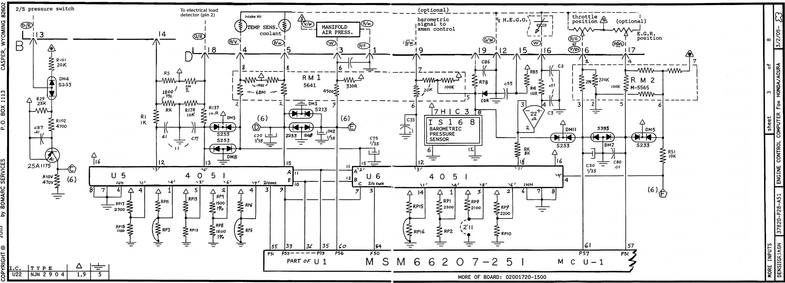
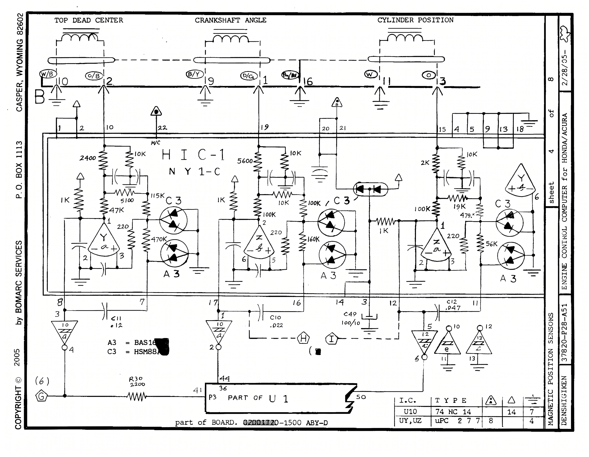
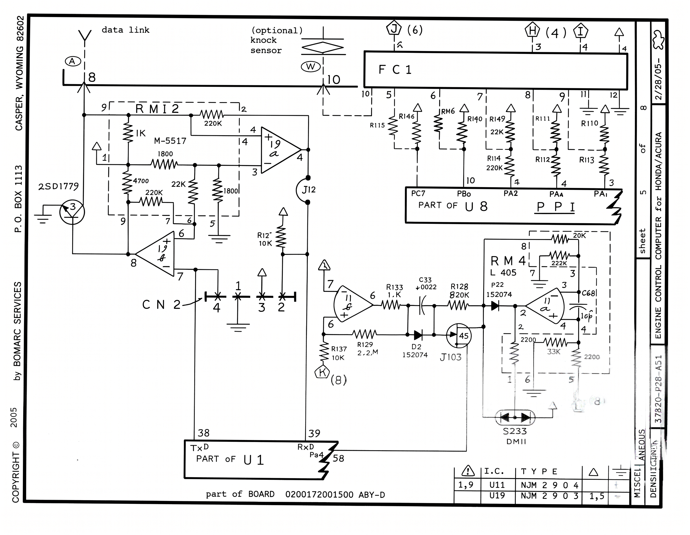
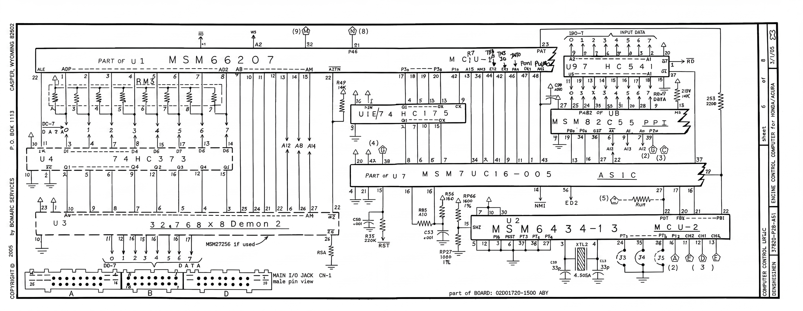
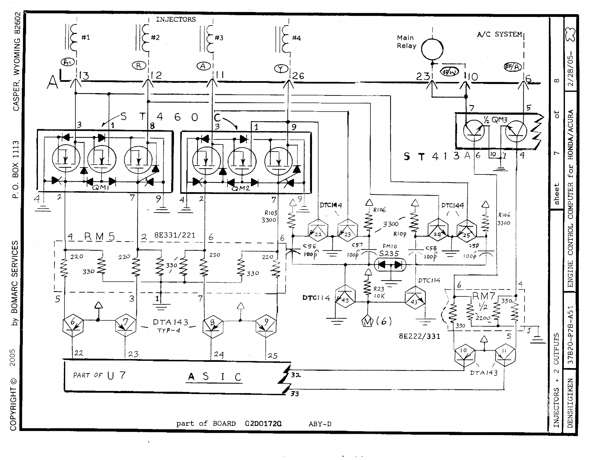
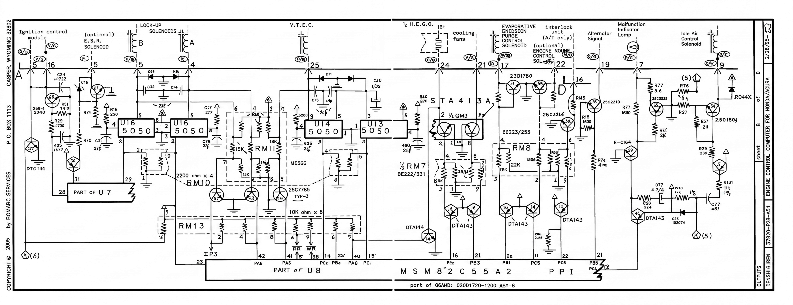

# Honda OBD1 P28 ECU Internal Schematics

Written breakdown of the Bomarc reverse-engineered board set **37820-P28-A51** (*Engine Control Computer for Honda/Acura*, 8 sheets, 2005). Stock OBD1 P28 covered SOHC VTEC D-series cars across markets: 92-95 Civic EX/Si (USDM D16Z6), Del Sol VTEC (D16Z6), and EDM/other Civic and Del Sol codes (P28-G0x / P28-Q50 etc.) including D16Z9 applications. Related OBD1 boards share a lot of this layout; optional circuits on the sheets may not be populated on every board. Match your revision (02D011F0-1500 / 02D01720-1500, auto vs manual).

For RAM/ROM maps and board photos see the [P28 ECU reference](/cars/sensors/p28/p28). Harness side: [OBD1 wiring](/cars/wiring/obd1/obd1), [ECU connections](/cars/wiring/ecu-connections/ecu-connections).

> [!WARNING]
> Third-party reverse-engineered drawing, not a Honda factory schematic. Values come from a scan - unclear bits are called out. Confirm critical nets on a real board before cutting traces.

---

## Drawing info

| Field | Value |
| :--- | :--- |
| Drawing | 37820-P28-A51 |
| Title | Engine Control Computer for Honda/Acura |
| Author | Bomarc Services, Casper, Wyoming (2005) |
| Honda ref on title block | 761-211159 ARN (as printed; not cross-checked against Honda catalogs) |
| Maker mark | DENSHIGIKEN |
| Sheets | 1 of 8 through 8 of 8 |
| Board mark on several sheets | 02D01720-1500 (ABY-D / ABY variants); sheet 8 also shows 02D01720-1200 ASY-8 |

### Legend (sheet 1)

| Symbol | Meaning |
| :--- | :--- |
| Hexagon with letter/number | Net continues on another sheet |
| Filled arrow / triangle on a net | Net ends on this sheet |
| Circle with letter code | Harness wire color (Y/B = yellow/black, etc.) |

### Files

* [P28_ECU_Civic.pdf](P28_ECU_Civic.pdf) - preferred 8-page landscape scan (one sheet per page). Hosted by **[imtheman0313](https://github.com/imtheman0313)** in [Honda-Civic-P28-ECU](https://github.com/imtheman0313/Honda-Civic-P28-ECU); that is the legible scan used for the sheet images and transcription below.
* [FinishedP28PinoutCORRECTED.png](FinishedP28PinoutCORRECTED.png) - corrected harness pinout graphic from the same repo
* The common 11-page portrait file (`P28 Schematics.pdf` / `bomarc-services-p28.pdf`) is the same Bomarc 8 sheets, just a lower-res split scan

---

## Connector pinout (harness side)

Corrected community pinout for P28 / P06-class OBD1 plugs A, B, and D. Connector C is not on this graphic. Integra wire colors appear where the source diagram listed them; that does not mean Integra used a P28 from the factory.


*P28/P06 harness pinout with multi-model empty/optional slots noted*

### Connector A (26-pin)

| Pin | Function | Wire color | Notes |
| :---: | :--- | :--- | :--- |
| A1 | IGP2 power | yellow/black | |
| A2 | PG1 power ground | black | |
| A3 | ICM (ignition control module) | red/green | |
| A4 | ICS intake control sol. (H22A) | white | Empty on Civic |
| A5 | IAB intake air bypass sol. | pink | Integra GSR B18C on the overview |
| A6 | A/C compressor clutch | black/red | |
| A7 | MIL | green/orange | |
| A8 | EGR solenoid | red or org/blue | |
| A9 | IACV | green/white | |
| A10 | Fuel pump relay | green/yellow (Civic); green/blue (Integra note) | |
| A11 | Injector 3 | light blue | |
| A12 | Injector 2 | red | |
| A13 | Injector 1 | brown | |
| A14 | LG1 logic ground | black/red | |
| A15 | PG2 power ground | black | |
| A16 | ICM (second IGM label on overview) | red/green | Unclear if this is a real second pin or a diagram error vs A3 |
| A17 | Evap purge sol. | red | |
| A18 | TCM (A/T) | - | Empty on 5spd Civic |
| A19 | Alternator control | white/green | |
| A20 | Empty | - | |
| A21 | Radiator fan control | yellow/green | |
| A22 | Engine mount control | green/white | |
| A23 | Fuel pump relay (second FLR label) | green/blue | Unclear how this relates to A10 on the overview |
| A24 | Primary O2 heater | yellow/black | Civic VX / 5-wire O2 notes on overview |
| A25 | VTEC solenoid | orange/white | |
| A26 | Injector 4 | yellow | |

### Connector B (16-pin)

| Pin | Function | Wire color | Notes |
| :---: | :--- | :--- | :--- |
| B1 | CKP P | blue/yellow | |
| B2 | TDC P | orange/blue | |
| B3 | CYP P | orange | |
| B4 | Starter signal | blue/white (Civic); white/red (Integra note) | |
| B5 | Clutch switch / A/T | pink/black or green | Empty on many CX/DX/LX/EX/Si |
| B6 | A/C switch | blue/red | |
| B7 | A/T related | - | Empty on 5spd |
| B8 | IGP1 power ground | yellow/black | |
| B9 | CKP M | blue/yellow | |
| B10 | TDC M | white/blue | |
| B11 | CYP M | white | |
| B12 | VSS | yellow/blue or orange | |
| B13 | P/S pressure switch | red/green | Empty CX/DX/VX |
| B14 | Empty | - | |
| B15 | A/T related | - | Empty on 5spd |
| B16 | LG2 logic ground | brown/black | |

### Connector D (22-pin)

| Pin | Function | Wire color | Notes |
| :---: | :--- | :--- | :--- |
| D1 | SG1 sensor ground | grn/blue (Civic); yel/blue (Integra note) | |
| D2 | VCC1 (MAP ref) | yel/green (Civic); red/white (Integra note) | |
| D3 | MAP | white (Civic); white/blue (Integra note) | |
| D4 | IAT | red/yellow | |
| D5 | ECT | red/white or yel/blue | |
| D6 | TPS | light green or red/black | |
| D7 | Alternator FR | pink or white/red | |
| D8 | Data link TXD/RXD | light blue or light green/red | |
| D9 | Empty | - | |
| D10 | Knock sensor | red/blue | Empty on many Civics |
| D11 | VBU (backup power) | white/blue or wht/yel | |
| D12 | SG2 sensor ground | green/white | |
| D13 | VCC2 (TPS ref) | yellow/white | |
| D14 | Interlock (A/T) | white/red | Optional / empty on many manuals |
| D15 | Empty / 5-wire O2 IP-, VS- | blue/green | VX notes on overview |
| D16 | Primary heated O2 | white or white/red | 1-wire vs 5-wire depends on car |
| D17 | EGR valve lift | white/black | Civic VX style; empty elsewhere |
| D18 | ELD | green/red or grn/blk | |
| D19 | Empty / 5-wire O2 VS+ | - | |
| D20 | VTEC pressure switch | orange/blue or light blue | |
| D21 | Service check (SCS) | brown (Civic); brown/white (Integra note) | |
| D22 | Brake switch | green/white | |

Pin numbers on the Bomarc sheets below are the ECU edge pins as drawn. Cross-check colors against your harness.

---

## Sheet images

```carousel

*Sheet 1 of 8 - power supply*
<!-- slide -->

*Sheet 2 of 8 - switch / digital inputs*
<!-- slide -->

*Sheet 3 of 8 - analog sensors, muxes, baro*
<!-- slide -->

*Sheet 4 of 8 - TDC / CKP / CYP (HIC-1)*
<!-- slide -->

*Sheet 5 of 8 - serial data link and optional knock*
<!-- slide -->

*Sheet 6 of 8 - MCU-1, MCU-2, ASIC, PPI, bus*
<!-- slide -->

*Sheet 7 of 8 - injectors, main relay, A/C*
<!-- slide -->

*Sheet 8 of 8 - ignition, VTEC, solenoids, MIL, IAC, fans*
```

---

## Sheet 1 - Power supply

Title block: **POWER SUPPLY**, sheet 1 of 8, dated 2/27/05.

### Connector feeds

| Conn | Pin | Label | Wire (as drawn) | Notes |
| :---: | :---: | :--- | :--- | :--- |
| A | 1 | Ign B+ | Y/W | Switched ignition feed |
| B | 8 | - | - | Tied into the power tree; no wire color on this sheet |
| D | 2 | pwrgnd | BK | Power ground as labeled by Bomarc (not the same role as harness-table D2 VCC) |
| D | 20 | Batt B+ | Y/G | Constant battery |
| D | 11 | Batt B+ related | W/B | Parallel battery path |
| D | 15 | - | - | Also grounded on this sheet (triangle terminator) |

Power nets leave this sheet toward the logic pages (intersheet hex nets).

### Main parts

| Ref | Marking | Role |
| :--- | :--- | :--- |
| U23 | 00015 | Hybrid power package (dashed outline on drawing); pins 1/3/4 into L1/L2 and the +5 V tree |
| U17 | TA8903 | Main power / reset companion. Grounds on pins 5 and 6; pin 8 through a 29 Ω path; pins 2/4/7/9/12 into the +2.5 V / +4.3 V / MCU side |
| U1 | MCU-1 | Power pins 26, 28, 63, 64 (FLT VREF area); grounds 32, 52, 62; MCLK/crystal side 29-31; pin 33 and pin 47 also in this region |
| U20 | 74HC00 | NAND gates in the reset/enable area (VCC pin 14, GND pin 7) |

### Passives worth noting

* R21 100 Ω on Ign B+ into the protection network
* SR4418 plus D5 on the +12 V branch (series protection)
* NF1 filter on Batt B+ with C19 (33/35) and R22 2200 Ω; C20 0.01 and R49 10 kΩ on the VREF side
* D6 marked 1AZ21V / 21VV class on the Batt B+ sense path into MCU pin 31
* +5 V into the U17 region; +4.3 V near **2SB1068** (PNP) with R23 22.02, R24 10 kΩ, R25 45.3 kΩ / 1%
* Crystal on MCU-1: XTL1, CA1/CA7 10 pF, crystal marked **10AKSS3C**
* U20 gates with R27 10 kΩ and C45 0.001 into the reset domain; C82 0.001 ×2 near the second NAND

Sheet 1 is Ign B+, Batt B+, grounds, and the regulated rails for everything else. TA8903 pin map is only partly annotated on the drawing.

---

## Sheet 2 - Misc inputs

Title block: **MISC. INPUTS**, sheet 2 of 8, dated 3/1/05.

### Switch inputs

| Conn | Pin | Function | Wire |
| :---: | :---: | :--- | :--- |
| B | 4 | Ign B+ (start) / starter path | B/W |
| B | 5 | A/T park & neutral | G |
| B | 12 | VSS speed pulses | Y/B |
| B | 15 | Gear drive 4 | G/R |
| B | 6 | A/C system | B/R |
| D | 21 | Service check | Brn |
| D | 20 | VTEC pressure switch | G/B |
| D | 7 | Alternator FR | P |
| D | 22 | Brake switch | G/W |
| B | 7 | Gear drive 3 | G/B |

### Hybrid block into MCU-1

Large multi-device hybrid feeds **INTO PART OF U1** at pins **40** and **56** (as labeled). Bus nets out of the hybrid are labeled **ID0, ID1, ID4, ID5, ID6, ID7**.

| ID | Marking | Role |
| :--- | :--- | :--- |
| A1 | FMA1A | Input array |
| B3 | HSM2694 | Input array |
| C3 | HSMBGASR | Input array |
| L5 | MMBC1623L5 | Transistor array |
| L31 | (no separate PN on legend) | Transistor array |
| M5 | MMBTAB12M5 | Transistor array |

Several M5 stages condition gear, VSS, A/C, SCS, VTEC pressure, alt FR, and brake before they hit MCU-1. Gear drive 3 has an external **2SA1195** stage into **ID6**.

### Glue

* Comparator/op-amp path near ID0 with R94 300 kΩ, C6 0.63/35, R89 10 kΩ (amplifier labeled near pins 6/7/8 into ID0)
* Note on the sheet: *For glue chip rail see U10 on sheet 4, U22 on sheet 3*

This sheet is digital/switch inputs, not the analog sensors.

---

## Sheet 3 - Analog sensor inputs

Title block: **MORE INPUTS**, sheet 3 of 8, dated 3/2/05.

MCU marking on this sheet: **MSM66207-251**, MCU-1, board **02D01720-1500**.

> [!NOTE]
> Suffix -251 is what Bomarc printed. Other P28 baseroms use different MCU IDs (230, 304, etc.). Do not assume every P28 is a 251.

### Sensor connections

| Conn | Pin | Function | Wire | Notes |
| :---: | :---: | :--- | :--- | :--- |
| B | 13 | P/S pressure switch | B/R | Into discrete front-end (2SA1175), then U5 |
| D | 18 | ELD (electrical load detector) | G/R | Labeled "to electrical load detector (pin 2)" on the sheet |
| D | 4 | IAT (intake air temp) | R/Y | |
| D | 5 | ECT (coolant temp) | R/W | |
| D | 3 | MAP (manifold air press.) | W | |
| D | 1 | MAP / sensor reference network | R/L | Into RM1 |
| D | 19 | Baro / optional path | B/W | Optional barometric signal to transmission control |
| D | 12, 15, 16 | HEGO (O2) | G/W, W | |
| D | 6 | TPS (throttle position) | R/R | Optional path also drawn |
| D | 17 | EGR position | G/BK | Market-specific / optional |

### ICs

| Ref | Type | Role |
| :--- | :--- | :--- |
| U5 | 4051 | Analog mux toward MCU ADC |
| U6 | 4051 | Second mux |
| U1 | MSM66207-251 | ADC-side ports labeled **P51, P55, P33, P34, P36, P50, P54, P57, P61** |
| HIC3 / IS168 | Barometric pressure sensor hybrid | Optional on-board baro |
| RM1 | 5641 network | MAP / sensor scaling |
| RM2 | M-5565 network | TPS / EGR area |
| U22 | NJM2904 | Dual op-amp (title-block IC table; drawing text can look like NJN) |

### Discretes

* P/S front-end: **2SA1175**, DM4 **S255**, R101 **20 kΩ**, R29 **23 kΩ**, R102 4700
* Several S233 / S253 diode packs for protection (DM5, DM8, DM11, etc.)
* Op-amps around HEGO/TPS with R85 10 kΩ, R78 100 kΩ, etc.

Sensors are muxed through the 4051s into the 66207 ADC. Channel-to-sensor mapping is only partly annotated on the drawing.

---

## Sheet 4 - TDC / CKP / CYP

Title block: **MAGNETIC POSITION SENSORS**, sheet 4 of 8, dated 2/28/05. Board note: **02D01720-1500 ABY-D**.

### Sensors

| Sensor | Pins | Wires |
| :--- | :--- | :--- |
| Top dead center | B10, B2 | W/B, O/B |
| Crankshaft angle | B9, B1 | B/Y, G/Y |
| Cylinder position | B16, B11, B3 | **B/W**, W, O |

### Conditioner

| Ref | Marking | Role |
| :--- | :--- | :--- |
| HIC-1 | NY1-C | Magnetic pickup conditioner for TDC/CKP/CYP |
| A3 | BAS16 | Diode array |
| C3 | HSM88A | Array |

Comparators shape the three channels, then feed **PART OF U1** at pins **P3, 41, 36, 44, 50** (as labeled). Intersheet net **H** and hex **(1)** leave the CKP path.

### Glue

| Ref | Type | Notes |
| :--- | :--- | :--- |
| U10 | 74HC14 | Schmitt inverters (VCC 14, GND 7) |
| UY, UZ | µPC277 | Comparators/amps (VCC 8, GND 4) |

Standard Honda three-sensor distributor interface. HIC-1 internals are not expanded on the drawing.

---

## Sheet 5 - Data link and knock

Title block: **MISCELLANEOUS**, sheet 5 of 8, dated 2/28/05. Board: **02D01720-1500 ABY-D**.

### External

| Conn | Pin | Function | Notes |
| :---: | :---: | :--- | :--- |
| D | 8 | Data link | Serial to the DLC |
| D | 10 | Knock (optional) | Not on every P28 |

### Blocks

| Ref | Type | Role |
| :--- | :--- | :--- |
| RM12 | M-5517 network | Data-link front end |
| 2SD1779 | NPN | Line driver / level stage |
| Op-amps | - | Shape TX/RX (CN2 diode steering into MCU) |
| U1 | MCU-1 | **TxD pin 38**, **RxD pin 39**, **Pa4 pin 58** |
| FC1 | Hybrid / connector block | Routes intersheet nets **J(6), H(4), I** |
| U8 | PPI (82C55 class) | **PC7, PB0, PA2, PA0, PA1** in this area |
| RM4 | L405 network | Knock / filter scaling |

Legend table lists **U11 NJM2904** and **U19 NJM2903**.

Diagnostic serial goes through discrete line drivers into MCU UART pins. Knock is optional.

---

## Sheet 6 - Computer control logic

Title block: **COMPUTER CONTROL LOGIC**, sheet 6 of 8, dated 3/1/05. Board: **02D01720-1500 ABY**.

This is the main digital sheet.

### Devices

| Ref | Marking | Role |
| :--- | :--- | :--- |
| U1 | MSM66207 (MCU-1) | Main OKI MCU: multiplexed bus, control, ADC (other sheets), UART (sheet 5) |
| U2 | **MSM6434-13** (MCU-2) | Second MCU. Ports include P16, PSST, PT3, PT6, PT4, PT5, PT3, PT2, CH1, CH2, CH4; crystal **XTL2** 4.505A with 33 pF caps |
| U7 | MSM7UC16-005 ASIC | Glue between MCU-1, bus, and powertrain I/O |
| U8 | MSM82C55 PPI | 8255-style parallel I/O (PA/PB/PC) |
| U9 | 74HC541 | Octal buffer on **ID0-7** input data toward **RD** |
| U18 | 74HC175 | Flip-flops on control/address |
| U4 | 74HC373 | Octal latch on the multiplexed data bus |
| U3 | 324768×8 "Demon 2" | EPROM / memory socket region; drawing also notes **MSM27256 if used** |
| CN-1 | Main I/O jack | Male pin view of connectors A / B / D |

### Bus (as drawn)

* Multiplexed address/data from MCU-1 through **RM3** and U4 HC373
* ID0-7 into U9 HC541, then RD
* Control lines between MCU-1, ASIC U7, PPI U8, and MCU-2
* NMI / RST area: **R35 220 kΩ**, **R56 1600 Ω 1%**, R85 4.7 kΩ, etc.
* Intersheet nets **(8), (9), (2), (3), (5)** continue to injector/output sheets

This is the usual OBD1 story: MCU + ASIC + 82C55 + optional EPROM. MCU-2 is clearly labeled **MSM6434-13** on the restored sheet (older transcription guessed MSM66513). "Demon 2" looks like a socketing/dev label, not a Honda production name.

---

## Sheet 7 - Injectors, main relay, A/C

Title block: **INJECTORS + 2 OUTPUTS**, sheet 7 of 8, dated 2/28/05. Board: **02D01720 ABY-D**.

### Injectors

| Cyl | Pin | Wire |
| :---: | :---: | :--- |
| #1 | A13 | Brn |
| #2 | A12 | R |
| #3 | A11 | Lt Blu (A) |
| #4 | A26 | Y |

### Drivers

| Ref | Type | Role |
| :--- | :--- | :--- |
| ST460 (QM1) | Low-side driver hybrid | Injectors 1-2 |
| ST460 (QM2) | Same | Injectors 3-4 |
| RM5 | 8E331/221 network | Series resistors into the drivers |
| DTA143 packs | Digital transistors (TYP-4) | Pre-drivers from ASIC U7 pins **22-25** |

### Main relay and A/C

| Output | Conn | Pin | Wire | Path |
| :--- | :---: | :---: | :--- | :--- |
| Main relay | A | 23 | G/Y | ST413A (½ QM3); pin **A10** also ties into this ST413A package |
| A/C | A | 6 | B/R | ST413A |

Pre-drivers use **DTC144** packs (ASIC pins 22-25 side), **DTC114** stages, **RM7** (8E222/331), **DM10 S235**, and intersheet **M(6)** into the ASIC. ASIC also shows pins **32/33** toward the ST413A pre-drive.

ST460 hybrids are the usual low-side injector switches (common failure parts on OBD1 boards). Drive comes from ASIC U7, not raw MCU pins.

---

## Sheet 8 - Outputs

Title block: **OUTPUTS**, sheet 8 of 8, dated 2/28/05. Board note on this sheet: **02D01720-1200 ASY-8** (other sheets say 02D01720-1500). PPI marked **MSM82C55A2**, part of U8.

### Outputs

| Function | Conn | Pin | Wire | Notes |
| :--- | :---: | :---: | :--- | :--- |
| Ignition control module | A | 3, 16 | R/G, Y/G | Dual ICM-related outputs |
| EGR solenoid (optional) | A | 8 | R | Labeled E.S.R. solenoid |
| Lock-up sol. B | A | 5 | G/R | A/T |
| Lock-up sol. A | A | 4 | Y | A/T |
| VTEC solenoid | A | 25 | **O/B** | |
| Cooling fans | A | 24 | Y/B | Labeled with ½ HEGO region on the sheet |
| Evap purge | A | 17 | R/BK | Evaporative emission control solenoid |
| Engine mount sol. (optional) | A | 22 | G/W | |
| Interlock (A/T only) | D | 14 | W/B | |
| Alternator signal | A | 19 | **G/G** | As drawn on this sheet |
| MIL | A | 7 | G/O | Malfunction indicator lamp |
| Idle air control | A | 9 | G/W | IAC solenoid |

### Drivers

| Ref | Type | Role |
| :--- | :--- | :--- |
| U13-U16 | 5050 | Quad drivers for ignition / lock-up / VTEC area |
| ST413A | Dual driver (½ QM3) | Fan / related outputs |
| 2SD1780, 2SC3214, 2SC2785, 2SC3525 | Discretes | Purge, mount, MIL, alt, IAC paths |
| RM8, RM10, RM11, RM13, RM7 | Resistor packs | 220 Ω ×4, 10 kΩ ×8, 8E222/331, etc. |
| DTA143 / DTC144 | Digital transistor packs | Pre-drivers from PPI and ASIC |

Control comes from ASIC U7 (left: pins around **28-31**) and PPI U8 port pins labeled on this sheet: **PA6, PA3, PC2, PB6, PA6, PC1, PB2, PB3, PB1, PC5, PC6, PB5**. Intersheet **(5)** and **(6)** continue shared enables.

VTEC, purge, MIL, IAC, fans, and A/T lock-up are PPI/ASIC low-side outputs on this drawing, not direct MCU pins. Optional labels again cover multi-market boards.

---

## How the sheets fit together

```
Batt B+ / Ign B+ / GND
        |
     Sheet 1
   TA8903 + regs
    +5V / +4.3V
        |
   +----+----+
   |    |    |
  S2   S3   S4
 switch analog TDC/CKP/CYP
   |    |    |
   +----+----+
        |
     Sheet 6                 Sheet 5
  MCU-1 / MCU-2 /          DLC + knock
  ASIC / 82C55 / EPROM
        |
   +----+----+
   |         |
 Sheet 7   Sheet 8
 injectors  VTEC, MIL, IAC,
 relay, AC  fans, purge, ICM
```

| Group | Sheet | Main silicon |
| :--- | :---: | :--- |
| Power / reset | 1 | TA8903, 74HC00, U23 00015, MCU power pins |
| Digital switches | 2 | FMA1A / HSM2694 hybrid arrays into MCU-1 |
| Analog sensors | 3 | 4051 ×2, NJM2904, baro HIC3/IS168, MCU ADC |
| Crank/cam | 4 | HIC-1 NY1-C, 74HC14, µPC277 |
| Diagnostics / knock | 5 | Line driver, NJM2903/2904, PPI slice |
| Digital core | 6 | MSM66207, **MSM6434-13**, ASIC, 82C55, HC541, HC373, EPROM |
| Fuel / relay | 7 | ST460 ×2, ST413A, ASIC |
| Spark / VTEC / lamps | 8 | 5050 ×4, discretes, PPI + ASIC |

---

## Limitations

1. Source is a raster scan, not a vector netlist. Small text can still be ambiguous even on the clarity-restored pages.
2. Optional circuits are drawn even when a given board leaves them off.
3. Some hybrid passives and a few PPI port digits remain hard to pin down; MCU-2 is labeled **MSM6434-13** on sheet 6.
4. Wire colors use Bomarc's abbreviations; regional harnesses can differ. Bomarc pin labels (e.g. sheet 1 D2 as pwrgnd) do not always match the community harness pinout table above.
5. The multi-model pinout graphic documents empty slots on purpose. Not every pin is live on every ECU.
6. Bomarc is not Honda factory documentation.

---

## Downloads

| File | What it is |
| :--- | :--- |
| [P28_ECU_Civic.pdf](P28_ECU_Civic.pdf) | Preferred 8-sheet PDF |
| [FinishedP28PinoutCORRECTED.png](FinishedP28PinoutCORRECTED.png) | Harness pinout graphic |

See also: [P28 ECU reference](/cars/sensors/p28/p28), [Add IAB to P28](/cars/sensors/add-iab-to-p28/add-iab-to-p28), [Disable VTEC VSS check](/cars/tuning/disable-vtec-vss-check-p28/disable-vtec-vss-check-p28), [Introduction to ECU chipping](/cars/tuning/introduction-to-ecu-chipping/introduction-to-ecu-chipping).

## Credits

* **Legible scan, per-sheet images, and corrected pinout:** [imtheman0313](https://github.com/imtheman0313) - [Honda-Civic-P28-ECU](https://github.com/imtheman0313/Honda-Civic-P28-ECU) (`P28_ECU_Civic.pdf`, `P28ECU/Page1-8.jpg`, `FinishedP28PinoutCORRECTED.png`).
* **Underlying reverse-engineered drawings:** Bomarc Services, 37820-P28-A51 (2005).
* Written sheet notes on this page are a Hondabase transcription of that scan, with unclear bits called out.
