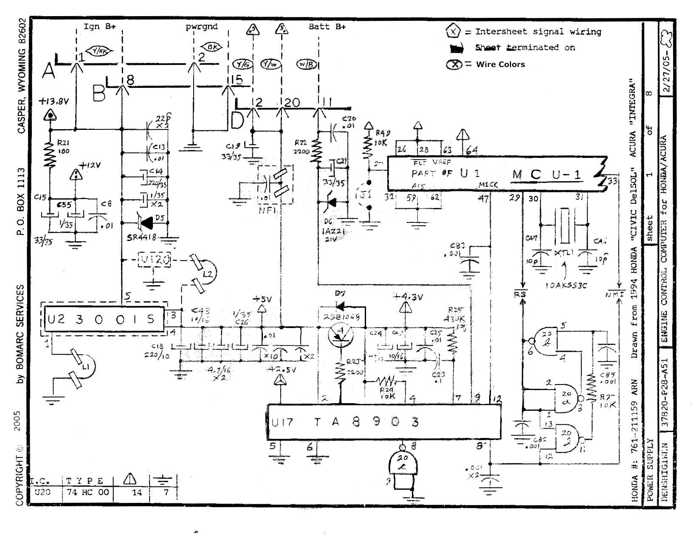
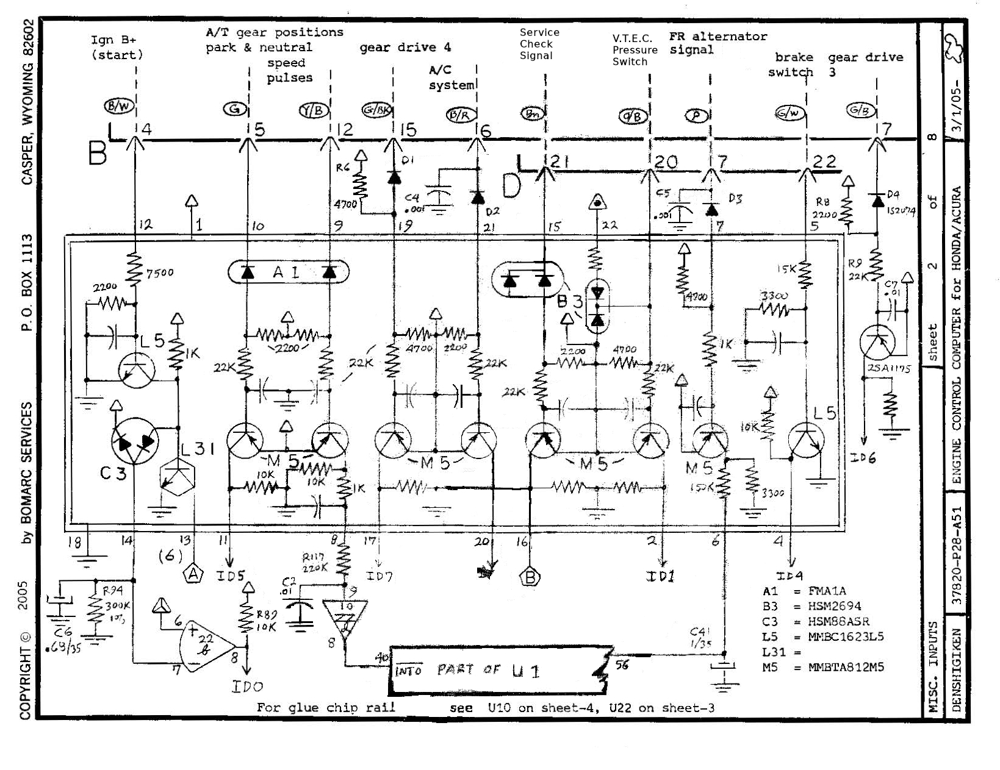
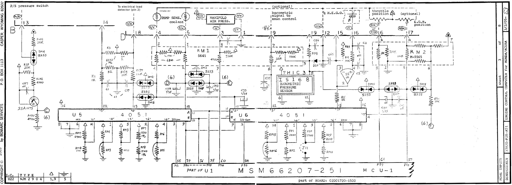
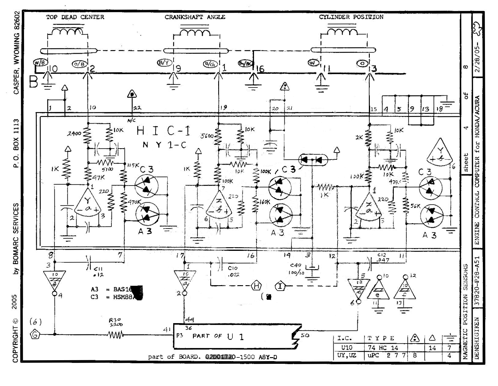
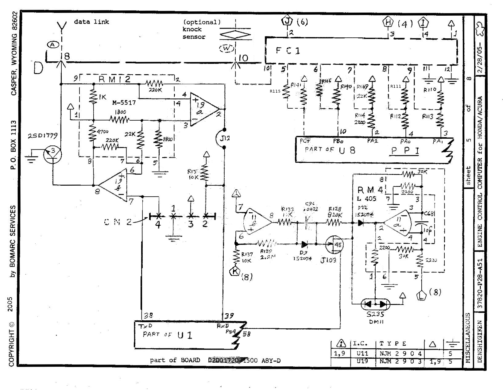
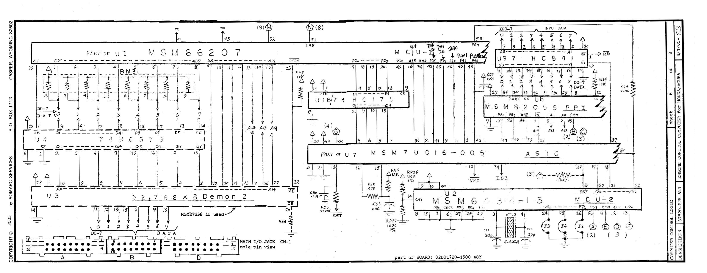
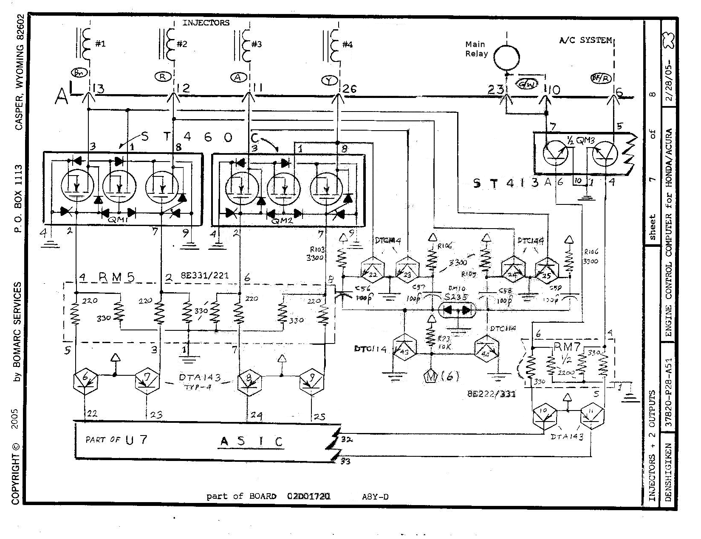
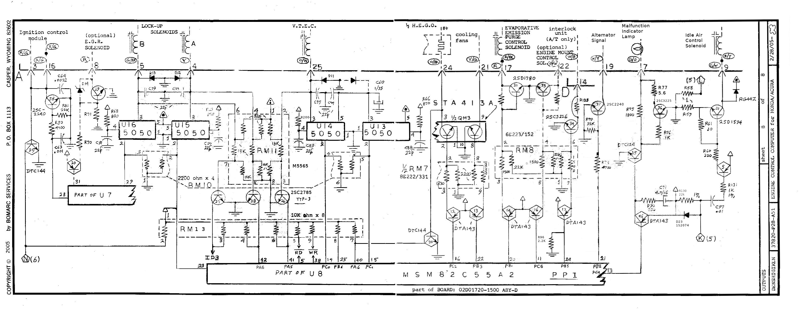

# Honda OBD1 P28 ECU Internal Schematics (Written Transcription)

This article is a **written decipherment** of the Bomarc Services reverse-engineered board schematic pack **37820-P28-A51** (*Engine Control Computer for Honda/Acura*, 8 sheets, 2005). It is intended for repair, reverse engineering, and understanding the shared OBD1 architecture used by the **P28** and closely related boards.

> [!WARNING]
> This is a transcription of a third-party reverse-engineered drawing, not an official Honda schematic. Values, net names, and IC pin numbers below are read from a scanned raster. Where the scan is ambiguous, items are marked **uncertain**. Do not cut traces or design hardware from uncertain nets without verifying on a real board.

---

## Scope and multi-vehicle applicability

### Factory P28 use

The **P28** ECU family was a **factory SOHC VTEC D-series** controller — not a universal “any Honda” OEM unit.

| Market / application | Typical notes |
| :--- | :--- |
| **1992–1995 Civic EX/Si (USDM)** | D16Z6 SOHC VTEC — primary USDM P28 application |
| **Del Sol VTEC (USDM / related)** | D16Z6 — chassis **EG-EH** family |
| **EDM Civic / Del Sol P28-G0x** | European P28 codes (e.g. G01/G02/G51) on related Civic/Del Sol bodies |

**Not factory P28 platforms** (common confusion):

* **DC2 Integra** — used OBD1/OBD2 Integra ECUs such as **P72** (GSR/Type R family), **P75** / **PR4** (non-VTEC LS/GS), etc. **Not P28.**
* **DA Integra** — OBD0/OBD1 Integra codes (PR4, etc.), not P28 as OEM.
* **CRX / EF** — OBD0-era USDM CRX; not a factory P28 application.
* **EK Civic** — OBD2 generation; not factory P28 (though people swap OBD1 P28 hardware into later cars).

### Why the schematic still “affects” multiple vehicles

| Context | What that means |
| :--- | :--- |
| **Shared OBD1 board family** | P05/P06/P07/P08/P30/P72/PR4/P75 and others share connector style and similar power/injector/MCU topology; **options and ROM differ**. This drawing is the P28-titled Bomarc set, not a substitute for every OBD1 ECU’s full schematic. |
| **Tuning baserom** | Socketed **P28** ROMs are widely used to run non-OEM engines (B-series, hybrids, etc.) in many chassis — that is a **swap/tuning** use of P28 hardware, not factory fitment. |
| **Drawing provenance (title block)** | Bomarc: *“Drawn from 1994 Honda Civic DelSol / Acura Integra”* — they used related OBD1 boards as reverse-engineering references. That does **not** mean DC2 (or any Integra) shipped with a P28. |
| **Optional circuits on the sheets** | A/T lock-up, knock, baro, EGR, engine mount, etc. appear even when a given market P28 omits them. Always match your board revision (**02D011F0-1500** / **02D01720-1500**, auto vs manual). |

Related guides: [P28 ECU reference](/cars/sensors/p28/p28) · [OBD1 wiring](/cars/wiring/obd1/obd1) · [ECU connections](/cars/wiring/ecu-connections/ecu-connections)

---

## Drawing identity and legend

| Field | Value |
| :--- | :--- |
| **Drawing number** | 37820-P28-A51 |
| **Title** | Engine Control Computer for Honda/Acura |
| **Author** | Bomarc Services, Casper, Wyoming (© 2005) |
| **Honda reference # (title block)** | 761-211159 ARN *(as printed; not verified against Honda part catalogs)* |
| **Manufacturer mark** | DENSHIGIKEN |
| **Sheet count** | **8 of 8** |
| **Board mark on several sheets** | part of BOARD: **02D01720-1500** (A8Y-D / ABY-D variants appear in title notes) |

### Legend (from sheet 1)

| Symbol | Meaning |
| :--- | :--- |
| Hexagon with letter/number | **Intersheet signal wiring** (nets that continue on other sheets) |
| Filled arrowhead / black triangle on net | **Sheet terminated on** (end of that net on this sheet) |
| Circle with letter code | **Wire color** (harness-side color abbreviations, e.g. Y/B = yellow/black) |

### Preferred download

* **[P28_ECU_Civic.pdf](P28_ECU_Civic.pdf)** — 8-page landscape scan (preferred; one sheet per page)
* A widely mirrored **11-page** portrait scan of the **same** 8 sheets also exists under names like `P28 Schematics.pdf` / `bomarc-services-p28.pdf` (identical content, split pages)

---

## Connector pinout overview (harness side)

Community-corrected multi-model pinout covering **P28 / P06-class** OBD1 harness connectors A, B, and D (connector C is not shown on this overview):


*Corrected P28/P06 harness pinout — multi-model notes included on empty/optional slots*

### Connector A (26-pin) — summary

| Pin | Function (overview diagram) | Wire color (overview) | Notes |
| :---: | :--- | :--- | :--- |
| A1 | IGP2 — power source | yellow / black | |
| A2 | PG1 — power ground | black | |
| A3 | IGM — ignition control module | red / green | |
| A4 | ICS — intake control solenoid (H22A) | white | **Empty on Civic & Integra** (H22 path) |
| A5 | IAB — intake air bypass control sol. | pink | Integra GSR B18C |
| A6 | ACC — A/C compressor clutch | black / red | |
| A7 | MIL — malfunction indicator light | green / orange | |
| A8 | EGR — EGR solenoid | red or org/blue | Civic SOHC or used for H22/H23 EGR |
| A9 | IACV — idle air control valve | green / white | |
| A10 | FLR — fuel pump relay | green / yellow (Civic); green / blue (Integra) | |
| A11 | INJ3 — injector 3 | light blue | |
| A12 | INJ2 — injector 2 | red | |
| A13 | INJ1 — injector 1 | brown | |
| A14 | LG1 — logic ground | black / red | |
| A15 | PG2 — power ground | black | |
| A16 | IGM — ignition control module *(second IGM label on overview — **uncertain** if duplicate of A3)* | red / green | Verify on board |
| A17 | PCS — evap purge control solenoid | red | |
| A18 | TCM (A/T related) | — | **Empty** for 5spd Civic & Integra |
| A19 | ALTC — alternator control | white / green | |
| A20 | EMPTY SLOT | — | |
| A21 | FAN — radiator fan control | yellow / green | |
| A22 | EMC — engine mount control | green / white | |
| A23 | FLR — fuel pump relay *(second FLR label on overview — **uncertain** relationship to A10)* | green / blue (Civic); green / blue (Integra) | Verify |
| A24 | PO2SHTC — primary O2 sensor heater | yellow / black | Civic VX D15Z1; HTCTRL (5-wire O2) |
| A25 | VTS — VTEC solenoid | orange / white | |
| A26 | INJ4 — injector 4 | yellow | |

### Connector B (16-pin) — summary

| Pin | Function | Wire color | Notes |
| :---: | :--- | :--- | :--- |
| B1 | CKP P — CKP ground P-side input | blue / yellow | |
| B2 | TDC P — TDC ground P-side input | orange / blue | |
| B3 | CYP P — CYP sensor P-side input | orange | |
| B4 | STS — starter signal switch | blue / white (Civic); white / red (Integra) | |
| B5 | M/T clutch switch (Civic VX only) / also used for A/T | pink / black or green (A/T) | Empty slot for many Civic CX/DX/LX/EX/Si |
| B6 | ACS — A/C switch signal | blue / red | |
| B7 | A/T related | — | Empty for 5spd |
| B8 | IGP1 — power ground | yellow / black | |
| B9 | CKP M — CKP ground | blue / yellow | |
| B10 | TDC M — TDC ground M-side signal | white / blue | |
| B11 | CYP M — CYP ground M-side signal | white | |
| B12 | VSS — vehicle speed sensor | yellow / blue or orange | |
| B13 | PSPSW — P/S power switch signal | red / green (Integra & Civic Si/EX) | Empty for Civic CX/DX/VX |
| B14 | EMPTY SLOT | — | |
| B15 | A/T related | — | Empty for 5spd |
| B16 | LG2 — logic ground | brown / black | |

### Connector D (22-pin) — summary

| Pin | Function | Wire color | Notes |
| :---: | :--- | :--- | :--- |
| D1 | SG1 — sensor ground | grn / blue (Civic); yellow / blue (Integra) | |
| D2 | VCC1 — sensor voltage for MAP | yellow / green (Civic); red / white (Integra) | |
| D3 | MAP — MAP sensor | white (Civic); white / blue (Integra) | |
| D4 | IAT — intake air temp | red / yellow | |
| D5 | ECT — engine coolant temp | red / white or yel / blue | |
| D6 | TPS — throttle position sensor | light green or red / black | |
| D7 | ALT FR — alternator FR charge signal | pink or white / red | |
| D8 | TXD/RXD — diagnostic data link | light blue or light green/red | |
| D9 | EMPTY SLOT | — | |
| D10 | KS — knock sensor | red / blue (Integra) | Empty many Civic; LHF on 5-wire O2 D15Z1 |
| D11 | VBU — voltage back up | white / blue or wht/yel | |
| D12 | SG2 — sensor ground | green / white | |
| D13 | VCC2 — sensor voltage for TPS | yellow / white | |
| D14 | Inter lock control unit (A/T related) | white / red | Civic CX/VX optional up-shift LT pink/green; empty many others |
| D15 | EMPTY / LHF SENSOR (5-wire O2) IP−, VS− | blue / green | Integra & Civic empty vs VX |
| D16 | Pho2S — primary heated O2 | white or white / red | Civic CX D15B8 1-wire O2; VX 5-wire IP+ |
| D17 | EGRL — EGR valve lift sensor (Civic VX) | white / black | Empty many others |
| D18 | EL (ELD) — electrical load detector | green / red or grn/blk | |
| D19 | EMPTY / LHF SENSOR (5-wire O2) VS+ | — | |
| D20 | VTPS/VTM — VTEC pressure switch | orange / blue or light blue | |
| D21 | SCS — service check signal | brown (Civic); brown / white (Integra) | |
| D22 | BKSW — brake switch | green / white | |

> [!NOTE]
> The overview pinout is a **multi-model OBD1 mash-up** (P28/P06-class harness notes, including Integra wire-color variants where the donor diagram listed them). Empty-slot notes are intentional. That does **not** imply Integra factory-fit P28 ECUs. Bomarc sheet pin numbers below are **ECU edge-connector pin numbers as drawn** and should be cross-checked when colors disagree.

---

## Schematic sheet images

```carousel

*Sheet 1 of 8 — Power supply*
<!-- slide -->

*Sheet 2 of 8 — Miscellaneous digital/switch inputs*
<!-- slide -->

*Sheet 3 of 8 — Analog sensors, multiplexers, barometric sensor*
<!-- slide -->

*Sheet 4 of 8 — TDC / CKP / CYP conditioner (HIC-1)*
<!-- slide -->

*Sheet 5 of 8 — Serial data link and optional knock*
<!-- slide -->

*Sheet 6 of 8 — MCU-1, MCU-2, ASIC, PPI, address/data bus*
<!-- slide -->

*Sheet 7 of 8 — Injector drivers, main relay, A/C interface*
<!-- slide -->

*Sheet 8 of 8 — Ignition, VTEC, solenoids, MIL, IAC, fans*
```

---

## Sheet 1 — Power supply

**Title block:** POWER SUPPLY · sheet **1 of 8** · date stamp **2/27/05**

### External connections (top of sheet)

| Conn | Pin | Label | Wire color (drawn) | Destination / notes |
| :---: | :---: | :--- | :--- | :--- |
| **A** | 1 | Ign B+ | Y/W *(uncertain reading of color blob)* | Switched ignition battery feed |
| **B** | 8 | — | — | Tied into power tree *(function **uncertain** from this sheet alone)* |
| **D** | 2 | pwrgnd | BK | Power ground |
| **D** | 20 | Batt B+ | Y/G or Y/W | Continuous battery feed |
| **D** | 11 | Batt B+ related | W/B | Parallel battery path |

Intersheet power triangles leave the sheet toward later logic pages.

### Major ICs and blocks

| Ref | Type / marking | Role (as drawn) |
| :--- | :--- | :--- |
| **U23** | **30015** *(marking as read; package style looks like a voltage regulator / power IC — **uncertain exact function**)* | Fed from battery/ignition tree; output area near +12 V rail |
| **U17** | **TA8903** | Multi-rail power / reset companion; pins into +5 V and +4.3 V networks; grounds on pins 5, 6; output/load pins 7, 8, 9, 12 toward MCU |
| **U1** | **MCU-1** (part of main microcontroller) | Power pins: VREF / VCC-related pins **26, 28, 63, 64**; ground-related **32, 59, 62**; crystal-adjacent **29, 30, 31**; additional power pin **33** |
| **U20** | **74HC00** | Quad NAND used as logic around reset / enable *(pins 14 VCC, 7 GND per legend table)* |

### Passive / discrete highlights

* **R21 100 Ω** from Ign B+ into protection network.
* **SR4418** (series element / polyfuse-class part — **uncertain exact part family**) and diode **D5** on +12 V branch.
* **NF1** noise filter on Batt B+ path with **C19 33/35** and **R22 2200 Ω**.
* **+5 V** rail generated into U17 pin region; **+4.3 V** labeled near zener/transistor stage (**2SB1069** family marking — reading **uncertain**).
* Crystal network on MCU-1: **XTL1**, caps **CA1 / CA7 10 pF**, part **10AK553C** *(crystal marking as read)*.
* Logic gates **U20** (74HC00) gate network with **R27 10 kΩ**, **C45 0.001**, feedback into MCU power/reset domain.

### Notes

* Sheet establishes **Ign B+**, **Batt B+**, **pwrgnd**, and regulated **+5 V / +4.3 V** for the rest of the ECU.
* Exact pin-to-pin map of TA8903 is only partially legible; treat pin numbers as **uncertain** unless confirmed on a datasheet + board.

---

## Sheet 2 — Miscellaneous inputs

**Title block:** MISC. INPUTS · sheet **2 of 8** · date stamp **3/1/05**

### External switch / digital inputs (top)

| Conn | Pin | Function (drawn label) | Wire color |
| :---: | :---: | :--- | :--- |
| **B** | 4 | Ign B+ (start) / starter path | B/W |
| **B** | 5 | A/T gear positions — park & neutral | G |
| **B** | 12 | Speed pulses (VSS) | Y/B |
| **B** | 15 | Gear drive 4 | G/BK |
| **B** | 6 | A/C system | B/R |
| **D** | 21 | Service check signal | Brn |
| **D** | 20 | VTEC pressure switch | G/B |
| **D** | 7 | FR alternator signal | P |
| **D** | 22 | Brake switch | G/W |
| **B** | 7 | Gear drive 3 | G/G |

### Hybrid / transistor array block

Large multi-device hybrid labeled with channels into **“INTO PART OF U1”** (MCU-1) at pins **48** and **56** *(pin numbers as read)*.

| Hybrid ID | Marking (legend) | Role |
| :--- | :--- | :--- |
| **A1** | **PMA1A** | Input array section |
| **B3** | **HSM2694** | Input array section |
| **C3** | **HSM88ASR** *(or HSM88ASR-class)* | Input array section |
| **L5** | **MMBC1623L5** | Transistor array |
| **L31** | *(marking partially illegible)* | Transistor array |
| **M5** | **MMBTA812M5** *(as read)* | Transistor array |

Multiple **M5** stages clamp/switch the gear, VSS, A/C, service-check, VTEC-pressure, alternator-FR, and brake inputs before they reach MCU-1.

### Glue logic

* Op-amp / comparator stage into **ID0** region with **R94 300 kΩ**, **C6 0.63/35**, **R89 10 kΩ**.
* Note on sheet: *“For glue chip rail see **U10** on sheet-4, **U22** on sheet-3.”*

### Notes

* This sheet is primarily **switched/digital vehicle inputs**, not analog sensors.
* Exact hybrid pinouts are dense; individual channel-to-MCU pin mapping beyond the two labeled entries is **uncertain**.

---

## Sheet 3 — Analog sensor inputs

**Title block:** ANALOG INPUTS *(sheet edge)* · sheet **3 of 8** · date stamp **3/2/05**

**MCU marking on this sheet:** **MSM66207-251** · **MCU-1** · *part of BOARD: 02D01720-1500*

> [!NOTE]
> MCU suffix **-251** is as printed on this Bomarc sheet. Other P28 baseroms use different MCU program IDs (e.g. 230, 304). Treat **-251** as the drawing’s reference marking, not a claim that every P28 is 251.

### External analog / sensor connections

| Conn | Pin | Function (drawn) | Wire color | Notes |
| :---: | :---: | :--- | :--- | :--- |
| **B** | 13 | P/S pressure switch | B/W | Into discrete transistor front-end then **U5** |
| **D** | 14 | To electrical load detector (pin 2) | G/R | ELD path |
| **D** | 4 | Intake air temp sensor | R/Y | |
| **D** | 5 | Coolant temp sensor | R/W | |
| **D** | 3 | Manifold air pressure (MAP) | W | |
| **D** | 1 | Sensor ground / VCC side of MAP network | G/R | |
| **D** | 19 | *(barometric / optional path region)* | B/W | Optional barometric signal to transmission control |
| **D** | 12, 15, 16 | H.E.G.O. (O2) | G/W, etc. | Heated exhaust gas oxygen |
| **D** | 6 | Throttle position (optional marking on path) | B/R | |
| **D** | 17 | E.G.R. position | G/BK | Optional / market-specific |

### Major ICs

| Ref | Type | Role |
| :--- | :--- | :--- |
| **U5** | **4051** (analog mux) | Multiplexes several analog channels toward MCU ADC pins |
| **U6** | **4051** (analog mux) | Second mux for additional analog channels |
| **U1** | **MSM66207-251** | ADC pin block **P51, P49, P32, P34, P35, P50, P57, P53**, etc. (numbers as read) |
| **HIC3 / IS168** | Hybrid — **BAROMETRIC PRESSURE SENSOR** | On-board baro hybrid (optional fit) |
| **RM1** | Resistor network **5641** | MAP / sensor scaling |
| **RM2** | Resistor network **M-5565** | TPS / EGR scaling region |
| **U22** | **NJM2904** | Dual op-amp (legend: pins 1,9 / 5) |

### Discrete highlights

* P/S switch front-end: **2SA1175**, **DM4 S233**, resistors **R101 22 kΩ**, **R29 22 kΩ**, **R102 4700 Ω**.
* Multiple **S233** diode packs for input protection.
* Op-amp stages around HEGO and TPS with **R85 10 kΩ**, **R98 100 kΩ**, etc.

### Notes

* Analog path is **muxed** (4051 ×2) into MSM66207 ADC ports — critical for understanding how many physical sensors share ADC resources.
* Exact mux channel truth table (which switch select lines map to which sensor) is only partially legible → **uncertain** channel map.

---

## Sheet 4 — Magnetic position sensors (TDC / CKP / CYP)

**Title block:** MAGNETIC POSITION SENSORS · sheet **4 of 8** · date stamp **2/28/05**

**Board note:** part of BOARD **02D01720-1500 A8Y-D**

### Distributor / crank sensors (top)

| Sensor | Conn pins (drawn) | Wire colors | Notes |
| :--- | :--- | :--- | :--- |
| **TOP DEAD CENTER** | **B10**, **B2** | W/B, O/B | Coil symbol |
| **CRANKSHAFT ANGLE** | **B9**, **B1** | B/Y, G/Y | Coil symbol |
| **CYLINDER POSITION** | **B16**, **B11**, **B3** | B/BK, W, O | Coil + shared returns |

### Conditioner hybrid

| Ref | Marking | Role |
| :--- | :--- | :--- |
| **HIC-1** | **NY1-C** | Magnetic pickup conditioner hybrid for TDC/CKP/CYP |

Supporting arrays:

| ID | Marking |
| :--- | :--- |
| **A3** | **BAS16** *(diode array)* |
| **C3** | **HSM88A** |

Multiple comparator / amp stages (triangle symbols) shape the three sensor channels, then feed **PART OF U1** at pins **P3**, **41**, **36**, **44**, **50** *(as labeled)*.

### Glue logic

| Ref | Type | Notes |
| :--- | :--- | :--- |
| **U10** | **74HC14** | Hex Schmitt inverter (legend: 14 VCC, 7 GND) |
| **UY, UZ** | **µPC277** *(as read)* | Comparators / amps in position path |

### Notes

* Classic Honda **TDC / CKP / CYP** three-sensor distributor interface.
* Hybrid internal schematic is not expanded — treat HIC-1 as a black box whose pin functions are only partly labeled.

---

## Sheet 5 — Data link and optional knock

**Title block:** MISCELLANEOUS · sheet **5 of 8** · date stamp **2/28/05**

**Board note:** part of BOARD **02D01720-1500 A8Y-D**

### External

| Conn | Pin | Function | Wire | Notes |
| :---: | :---: | :--- | :--- | :--- |
| **D** | 8 | Data link (TXD/RXD diagnostic) | — | Serial line to vehicle DLC |
| **D** | 10 | (optional) knock sensor | W | Not populated on all P28s |

### Blocks

| Ref | Type | Role |
| :--- | :--- | :--- |
| **RM12** | Resistor network **M-5517** | Data-link front-end network |
| **2SD1779** | NPN | Line driver / level stage for data link |
| Op-amp stages | — | Shape TX/RX; coupled via **CM2** capacitor network |
| **U1** | MCU-1 | **TxD** pin **38**, **RxD** pin **39**, **PS4** region **58** *(numbers as read)* |
| **FC1** | Hybrid / connector block | Routes intersheet nets **J(6), H(4), I** and supply triangles |
| **U8** | **PPI** (82C55-class — see sheet 6/8) | Port pins **PC7, PB0, PA2, PA0, PA1** in this region |
| **RM4** | **L405** resistor network | Knock / filter scaling |
| Op-amp near knock | — | Filters optional knock input toward MCU/ASIC |

### Legend table on sheet

| Ref | Type |
| :--- | :--- |
| **U11** | **NJM2904** |
| **U19** | **NJM2903** |

### Notes

* Confirms **serial diagnostic** path is MCU UART-class pins through discrete line interface, not a separate protocol IC on this sheet.
* Knock path is explicitly **optional**.

---

## Sheet 6 — Computer control logic (MCU sheet)

**Title block:** COMPUTER CONTROL LOGIC · sheet **6 of 8** · date stamp **3/1/05**

**Board note:** part of BOARD: **02D01720-1500 ABY**

This is the primary digital architecture sheet.

### Major devices

| Ref | Marking (as read) | Role |
| :--- | :--- | :--- |
| **U1** | **MSM66207** (**MCU-1**) | Main 16-bit OKI microcontroller — address/data bus, control, ADC (other sheets), UART (sheet 5) |
| **U2** | **MSM66513** (**MCU-2**) *(marking **uncertain** in places; drawn as second MCU)* | Secondary controller — ports **P70–P73**, **TEST**, **PSx**, **CH0/CH1**, crystal **XTL2** |
| **U7** | **MSM7UC16-005** **ASIC** | Honda/Denshigiken ASIC — glue between MCU-1, bus, and powertrain I/O |
| **U8** | **MSM82C55** **PPI** | 8255-class parallel interface — ports PA/PB/PC for discrete I/O expansion |
| **U9** | **HC541** (74HC541) | Octal buffer on **ID0–7 INPUT DATA** bus toward **RD** |
| **U18** | **74HC175** | Quad flip-flop on control/address qualifies |
| **U3 / U4** | Bus transceivers / latches | Multiplexed **AD0–AD7** / data path around EPROM region |
| **EPROM region** | **MSM27256 if used** | Optional external 32K EPROM (“Demon 2” socket region on drawing) |
| **CN-1** | **MAIN I/O JACK** | Male pin view of connectors **A / B / D** edge |

### Bus structure (as drawn)

* Multiplexed **address/data** from MCU-1 through resistor packs **RM3** and latches.
* **ID0–7 INPUT DATA** bus into **U9 HC541** then **RD** strobe.
* Control lines among MCU-1, ASIC **U7**, PPI **U8**, and MCU-2.
* **NMI** and **RST** networks with discrete R/C (**R25 220 kΩ**, **R27 1600 Ω**, etc.).
* Intersheet hexagons **(8), (9), (2), (3), (5)** continue I/O to injector/output sheets.

### Notes

* This sheet is why OBD1 boards are described as **MCU + ASIC + 82C55 + optional EPROM**.
* Exact MCU-2 type string is hard to read on the scan — **MSM66513** is the best reading but remains **uncertain**.
* “Demon 2” appears to be a socketing / development label on the EPROM area, not a production Honda name.

---

## Sheet 7 — Injectors + main relay + A/C

**Title block:** INJECTORS + 2 OUTPUTS · sheet **7 of 8** · date stamp **2/28/05**

**Board note:** part of BOARD **02D01720 A8Y-D**

### Injectors

| Injector | Conn pin | Wire color (drawn) |
| :---: | :---: | :--- |
| **#1** | **A13** | Brn |
| **#2** | **A12** | R |
| **#3** | **A11** | Lt Blu |
| **#4** | **A26** | Y |

### Driver ICs

| Ref | Type | Role |
| :--- | :--- | :--- |
| **ST460** (left package **QM1**) | Quad/low-side driver hybrid | Drives injectors #1–#2 region |
| **ST460** (right package **QM2**) | Same family | Drives injectors #3–#4 region |
| **RM5** | **8E331/221** resistor network | Base/gate series resistors into drivers |
| **DTA143** packs | Digital transistors | Pre-drivers from **PART OF U7 ASIC** pins **22, 23, 24, 25** |

### Main relay and A/C

| Output | Conn | Pin | Wire | Driver path |
| :--- | :---: | :---: | :--- | :--- |
| **Main relay** | **A** | **23** | G/Y | Via **ST413A** dual driver (**¼ QM3**) |
| **A/C system** | **A** | **6** | B/R | Via **ST413A** |

Pre-drivers use **DTC144 / DTA143** packs, **RM7**, and **SX35** diode array, with intersheet **M(6)** into the ASIC.

### Notes

* Injector low-side switches are **ST460** hybrids — common OBD1 failure items (also discussed in injector-driver test guides).
* Control origin is **ASIC U7**, not raw MCU pins.

---

## Sheet 8 — Outputs (ignition, VTEC, solenoids, MIL, IAC)

**Title block:** OUTPUTS · sheet **8 of 8** · date stamp **2/28/05**

**Board note:** part of BOARD: **02D01720-1500 A8Y-D**

**PPI marking:** **MSM82C55A2** · **PART OF U8**

### Output map (top of sheet)

| Function | Conn | Pin | Wire (drawn) | Notes |
| :--- | :---: | :---: | :--- | :--- |
| Ignition control module | **A** | 3, 16 | R/G, Y/G | Dual ICM-related outputs |
| E.G.R. solenoid (optional) | **A** | 8 | R | |
| Lock-up solenoid B | **A** | 5 | G/R | A/T |
| Lock-up solenoid A | **A** | 4 | Y | A/T |
| **V.T.E.C.** solenoid | **A** | 25 | O/W | |
| ½ H.E.G.O. I/B+ cooling fans | **A** | 24 | Y/B | Fan-related |
| Evaporative emission purge control solenoid | **A** | 17 | R/BK | |
| Engine mount control sol. (optional) | **A** | 22 | G/W | |
| Interlock unit (A/T only) | **D** | 14 | W/B | |
| Alternator signal | **A** | 19 | W/Y | |
| Malfunction indicator lamp | **A** | 7 | G/O | |
| Idle air control solenoid | **A** | 9 | G/W | |

### Driver devices

| Ref | Type | Role |
| :--- | :--- | :--- |
| **U13, U14, U15, U16** | **5050** | Quad driver ICs for ignition / lock-up / related outputs |
| **ST413A** | Dual driver | Fan / purge region (shared family with sheet 7) |
| **2SD1780, 2SC2240, 2SC3225, 2SD1524** | Discrete transistors | MIL, IAC, alternator, purge stages |
| **2SC2785** | Discrete | Mid-sheet driver |
| **RM8, RM10, RM11, RM13, RM7** | Resistor networks | Series packs (220 Ω ×4, 10 kΩ ×8, etc.) |
| **DTA143 / DTC144** | Digital transistor arrays | Pre-drivers from **U8 PPI** and **U7 ASIC** |

### Control sources

* **PART OF U7** (ASIC) on left side into ignition drivers.
* **PART OF U8** **MSM82C55A2 PPI** port pins (labels include **PA6, PA5, PC0, PB6, PA2, PC1, PC6, PB5, PB4, PC4**, etc. — several digits **uncertain**).
* Intersheet **K(5)** and **(6)** continue shared enables.

### Notes

* VTEC, purge, MIL, IAC, fans, and A/T lock-up are **PPI/ASIC-driven low-side outputs**, not direct MCU port pins on this drawing.
* Optional markings (EGR, engine mount, interlock) again reflect multi-vehicle coverage.

---

## Cross-sheet architecture summary

```
                    Batt B+ / Ign B+ / GND
                              │
                         [Sheet 1]
                      TA8903 + regs
                         +5V / +4.3V
                              │
        ┌─────────────────────┼─────────────────────┐
        │                     │                     │
   [Sheet 2]             [Sheet 3]             [Sheet 4]
  switch inputs         analog mux             TDC/CKP/CYP
  hybrids A1/B3…        4051 + baro            HIC-1 NY1-C
        │                     │                     │
        └──────────────┬──────┴──────────┬──────────┘
                       │                 │
                  [Sheet 6]         [Sheet 5]
               MCU-1 MSM66207        DLC + knock
               MCU-2 (secondary)
               ASIC MSM7UC16-005
               PPI  82C55
               HC541 / HC175 / EPROM
                       │
          ┌────────────┼────────────┐
          │            │            │
     [Sheet 7]    [Sheet 8]    (back to sensors)
     ST460 inj     5050 / ST413
     main relay    VTEC, MIL, IAC
     A/C           fans, purge, ICM
```

| Function group | Sheet | Key silicon |
| :--- | :---: | :--- |
| Power / reset | 1 | TA8903, 74HC00, MCU power pins |
| Digital vehicle switches | 2 | Hybrid arrays → MCU-1 |
| Analog sensors | 3 | 4051 ×2, NJM2904, baro HIC, MCU ADC |
| Crank/cam position | 4 | HIC-1 NY1-C, 74HC14, µPC277 |
| Diagnostics / knock | 5 | Line driver, NJM2903/2904, PPI slice |
| Digital core | 6 | MSM66207, ASIC, 82C55, HC541, EPROM |
| Fuel / relay | 7 | ST460 ×2, ST413A, ASIC |
| Spark / VTEC / lamps | 8 | 5050 ×4, discretes, PPI + ASIC |

---

## Known limitations of this transcription

1. **Raster source only** — no vector netlist; small text (resistor values, pin numbers) is error-prone.
2. **Optional circuits** are drawn even when a given P28/P06/P30 board omits them (knock, baro, A/T lock-up, EGR lift, engine mount).
3. **MCU-2 type**, some **hybrid part numbers**, and several **PPI port pin numbers** remain **uncertain**.
4. **Wire colors** on Bomarc sheets use the drawing’s color abbreviations; they can disagree with a specific regional harness.
5. **Multi-vehicle pinout overview** intentionally documents empty slots; do not assume every pin is live on every ECU.
6. Bomarc is **not** Honda factory documentation.

---

## Downloads and related articles

| Asset | Description |
| :--- | :--- |
| [P28_ECU_Civic.pdf](P28_ECU_Civic.pdf) | Preferred 8-sheet PDF |
| [FinishedP28PinoutCORRECTED.png](FinishedP28PinoutCORRECTED.png) | Multi-model harness pinout graphic |
| [P28 ECU reference](/cars/sensors/p28/p28) | RAM/ROM maps, board photos |
| [Add IAB to P28](/cars/sensors/add-iab-to-p28/add-iab-to-p28) | Hardware mod notes |
| [Disable VTEC VSS check](/cars/tuning/disable-vtec-vss-check-p28/disable-vtec-vss-check-p28) | Software-side VTEC speed check |
| [Introduction to ECU chipping](/cars/tuning/introduction-to-ecu-chipping/introduction-to-ecu-chipping) | Socketing practice |

*Schematic images transcribed from the public Bomarc 37820-P28-A51 8-sheet set (preferred landscape scan). Harness pinout graphic from the same schematic collection’s corrected pinout diagram.*
