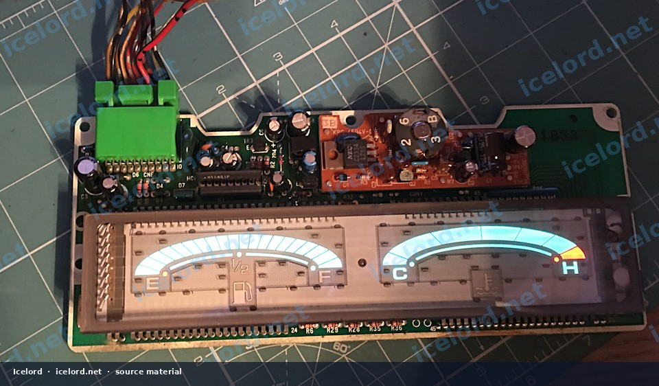
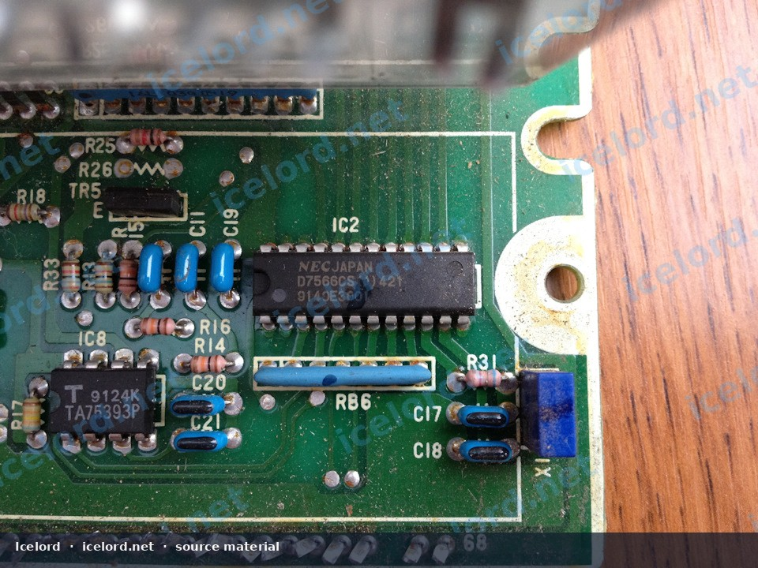
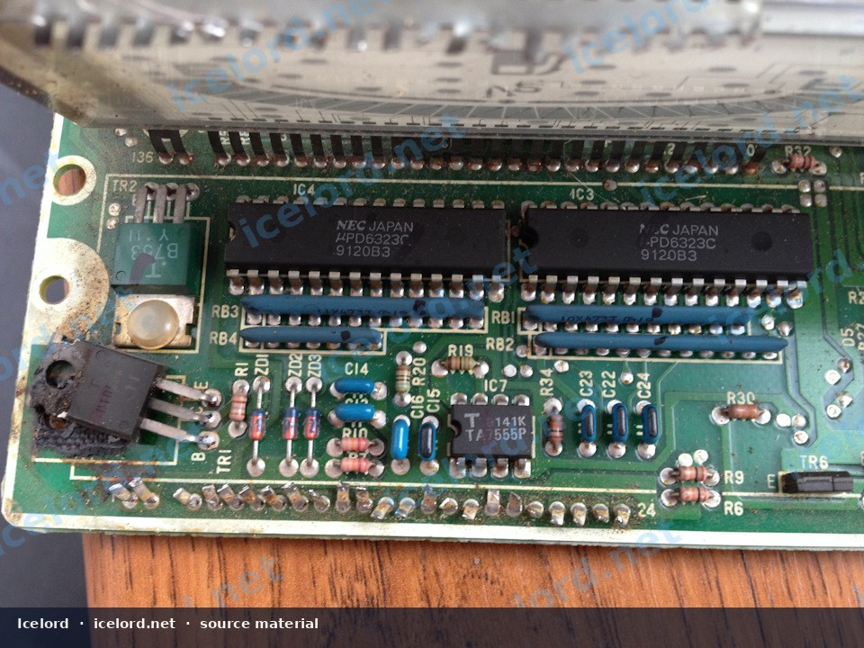
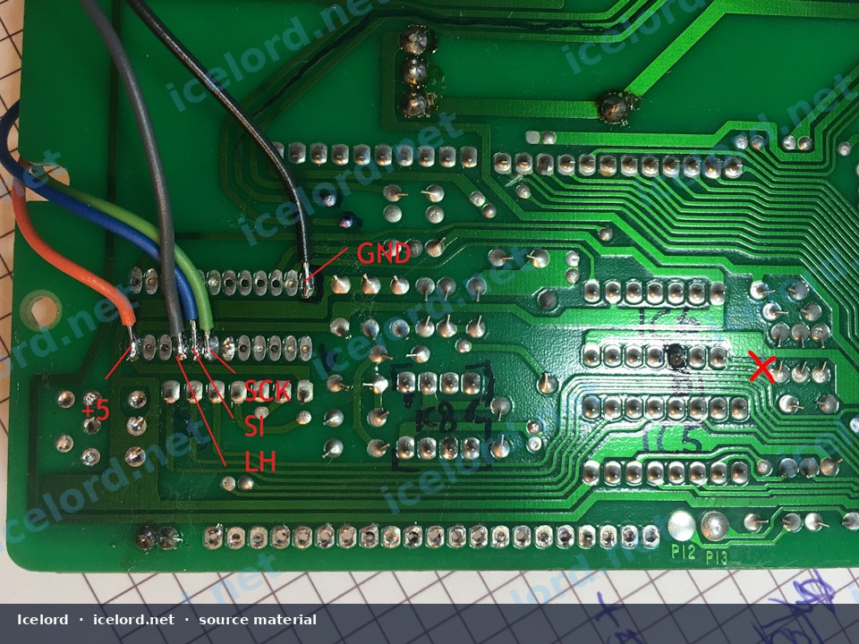
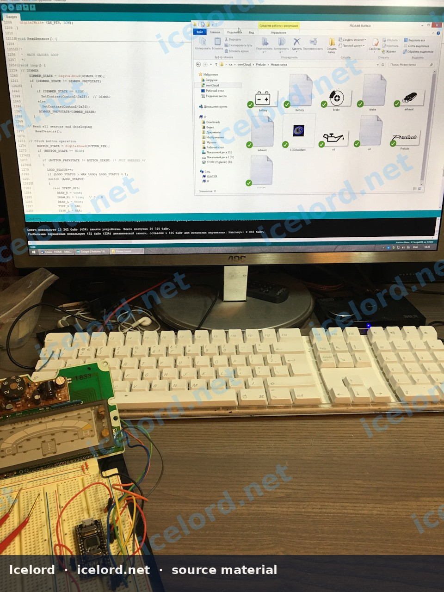
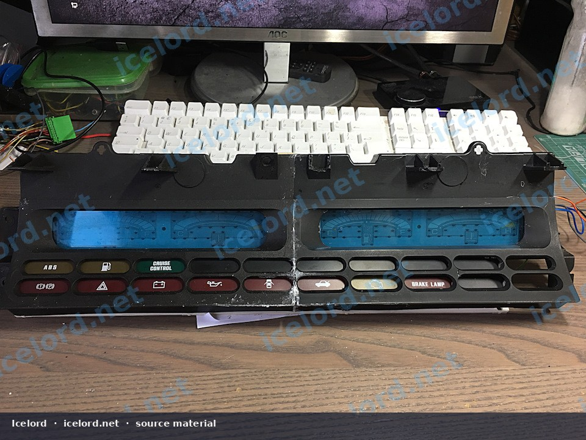
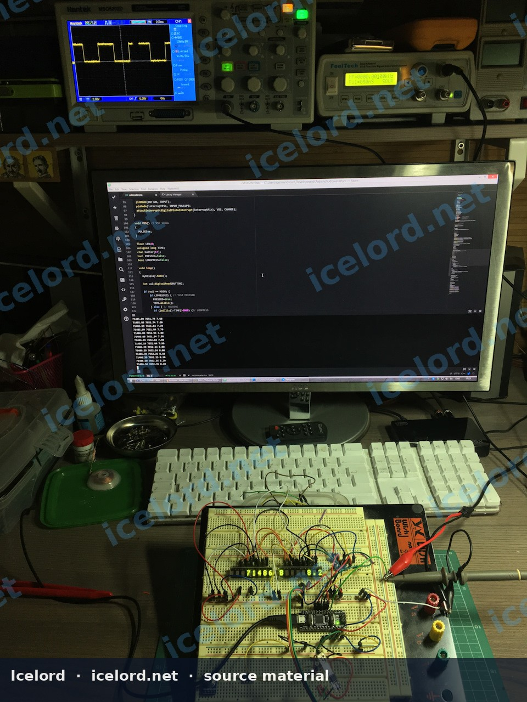
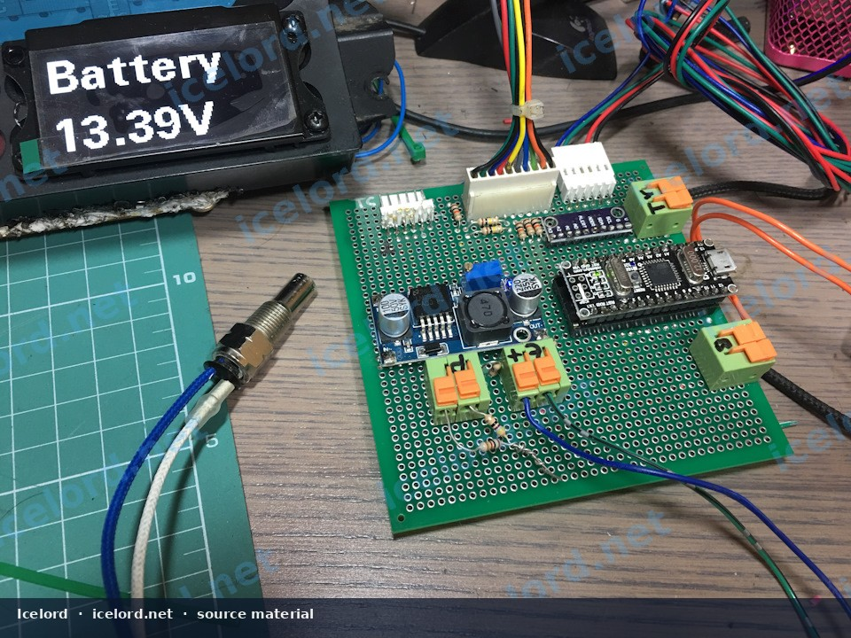
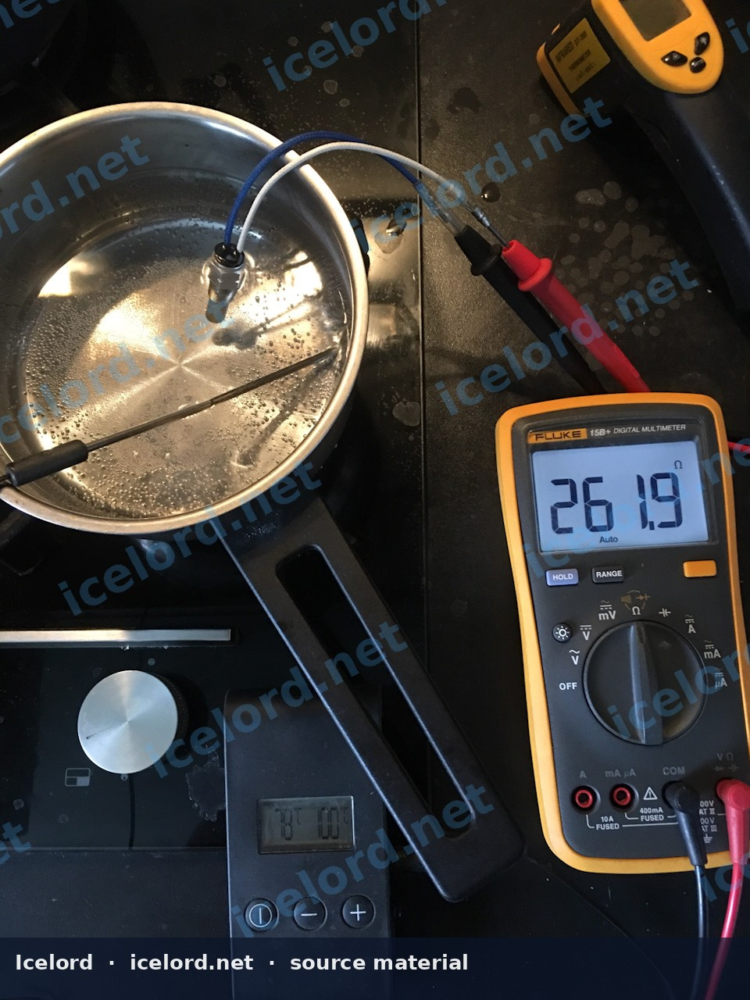
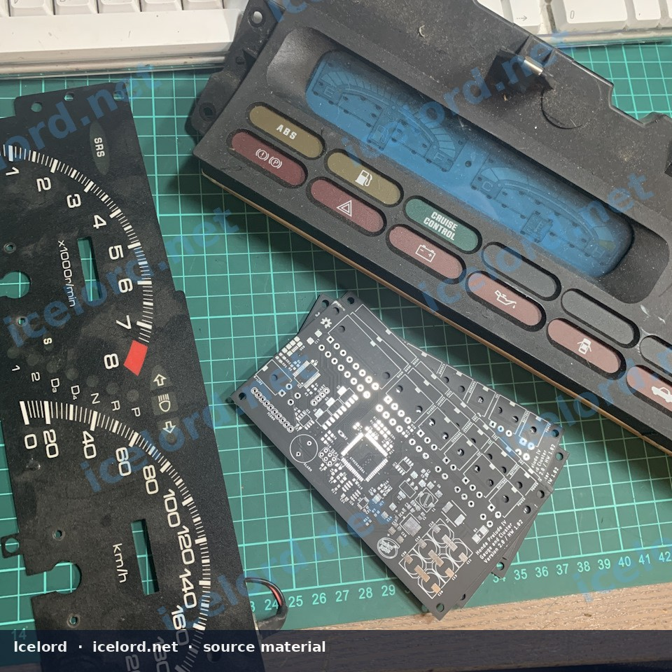

# Custom Auxiliary Gauge Display for Honda Prelude BB Chassis

This article outlines an advanced modification to integrate a custom auxiliary gauge display into the Honda Prelude BB chassis. This system enhances vehicle monitoring capabilities by displaying critical engine and vehicle parameters beyond the factory instrumentation, utilizing a microcontroller, existing Vacuum Fluorescent Displays (VFDs), and new OLED screens.

```carousel

<!-- slide -->

<!-- slide -->

<!-- slide -->

<!-- slide -->

<!-- slide -->

<!-- slide -->

<!-- slide -->


```

```carousel

<!-- slide -->

<!-- slide -->


```

## Challenges with OEM Gauge Cluster

The factory gauge cluster in the Honda Prelude BB chassis presents unique challenges for modification due to its integrated design. The fuel level and engine temperature gauges are controlled by a dedicated System-on-Chip (SOC), specifically the **μPD7566CS**. This SOC communicates with **μPD6232C** controllers that drive the VFD segments.

> [!IMPORTANT]
> The integrated digital control of the μPD7566CS makes direct manipulation of the factory fuel (21 segments) and temperature (7 segments) displays difficult. Achieving custom input scaling or responsiveness requires bypassing or replacing the SOC's control over the VFDs.

One method to gain control over the VFDs involves isolating the SOC. This typically requires precise circuit board modification, such as cutting the watchdog processor trace on the μPD7566CS to disable its native control.

## Custom System Architecture

The custom auxiliary gauge system is built around a central microcontroller unit (MCU), such as an ATmega2561 or ATmega328P. This MCU is responsible for processing sensor inputs, driving display outputs, and managing user interaction.

### Key Components:

*   **Microcontroller:** Processes all sensor data and controls display outputs.
*   **Vacuum Fluorescent Displays (VFDs):** The existing factory VFD segments for fuel and temperature are repurposed and driven by the custom MCU.
*   **OLED Screens:** Additional OLED displays (e.g., 2.24" 128x64 and 2" 128x32) are integrated to provide more detailed information, numerical readouts, and custom icons. These screens are chosen for their visual similarity to the factory VFDs.
*   **FRAM (Ferroelectric RAM):** Used for non-volatile storage of parameters, settings, and potentially odometer data, ensuring data persistence across power cycles.
*   **Input/Output Interfaces:**
    *   **K-Line:** For diagnostic communication and data logging.
    *   **USB:** For configuration, firmware updates, and data logging.
    *   **Opto-isolated I2C:** For communication with external modules, such as contactless brake temperature sensors or I/O expanders for other vehicle systems (e.g., 4WS).
*   **User Interface:** Control buttons for navigation and system settings, and an alarm buzzer for critical alerts.
*   **Power Management:** Filtered 5V power channels to ensure stable operation of sensitive electronics.

## Supported Sensors and Inputs

The custom system is designed to integrate a wide array of sensors, providing comprehensive monitoring capabilities:

| Sensor Type                  | Input Type      | Typical Application                     |
| :--------------------------- | :-------------- | :-------------------------------------- |
| **Oil Pressure**             | Resistive       | Engine oil pressure (e.g., VDO sender)  |
| **Oil Temperature**          | Resistive (NTC) | Engine oil temperature                  |
| **Air/Fuel Ratio (AFR)**     | Low-voltage     | Wideband oxygen sensor (Lambda)         |
| **Exhaust Gas Temperature (EGT)** | Thermocouple    | Exhaust gas temperature (high-temp K-type) |
| **Voltmeter**                | Voltage         | Vehicle system voltage                  |
| **Brake Temperature**        | I2C (PIR)       | Contactless brake disc temperature (e.g., MLX90614) |
| **Vehicle Speed Sensor (VSS)** | Digital Pulse   | Vehicle speed synchronization           |
| **Engine RPM**               | Digital Pulse   | Engine revolutions per minute           |
| **Dimmer (DIM)**             | Analog          | Instrument cluster illumination control |

## Installation and Modification Procedure

Integrating this custom display requires significant modification to the existing gauge cluster and vehicle wiring.

1.  **Acquire a Donor Cluster:** It is highly recommended to obtain a spare, non-working gauge cluster from a left-hand drive Prelude BB chassis for experimentation and modification. This prevents irreversible damage to the vehicle's primary cluster.
2.  **PCB Modification:** Carefully identify and modify the original gauge cluster's Printed Circuit Board (PCB). This involves isolating the μPD7566CS SOC, potentially by cutting specific traces (e.g., the watchdog processor trace) to disable its control over the VFDs.
3.  **Custom PCB Integration:** Design and integrate a custom PCB housing the MCU, FRAM, and other supporting circuitry. This PCB will interface with the modified VFDs and new OLED screens.
4.  **Display Integration:** Physically integrate the OLED screens into the cluster housing. This may require cutting and fabricating new mounting points within the cluster.
5.  **Sensor Wiring:** Install and route wiring for all new sensors (oil pressure, oil temperature, AFR, EGT, brake temperature, etc.) to the custom control unit. Ensure proper grounding and shielding for sensor signals.
6.  **Power and Communication Wiring:** Connect the custom unit to vehicle power, ground, VSS, RPM, and DIM inputs. Establish K-Line and USB connections for configuration and data access.

> [!CAUTION]
> This modification involves intricate soldering, circuit board alteration, and precise wiring. Incorrect procedures can lead to permanent damage to the gauge cluster or vehicle electrical system.

## Programming and Calibration

The custom system features built-in capabilities for calibration and configuration:

*   **Sensor Calibration:** The system allows for in-situ calibration of connected sensors, ensuring accurate readings.
*   **Parameter Storage:** All operational parameters and sensor calibration values are stored in FRAM, preserving settings even when power is removed.
*   **User Control:** Integrated buttons provide a means to navigate menus, adjust settings, and switch display modes.
*   **VSS Synchronization:** The system can synchronize with the Vehicle Speed Sensor (VSS) for accurate speed-dependent functions or data logging.

## Safety and Best Practices

> [!WARNING]
> Always disconnect the vehicle's battery before performing any electrical work or modifications to the gauge cluster.

> [!IMPORTANT]
> Confirm all wiring diagrams, pinouts, and component specifications against the official Honda Factory Service Manual (FSM) for your specific Prelude model and year. Do not rely solely on generalized information.

> [!TIP]
> Before final installation, thoroughly test the custom gauge system on a workbench using a donor cluster and simulated sensor inputs to verify functionality and prevent potential issues in the vehicle.

> [!NOTE]
> When selecting new sensors, ensure compatibility with the microcontroller's input specifications (e.g., voltage ranges, signal types) and consider automotive-grade components for reliability and durability.
