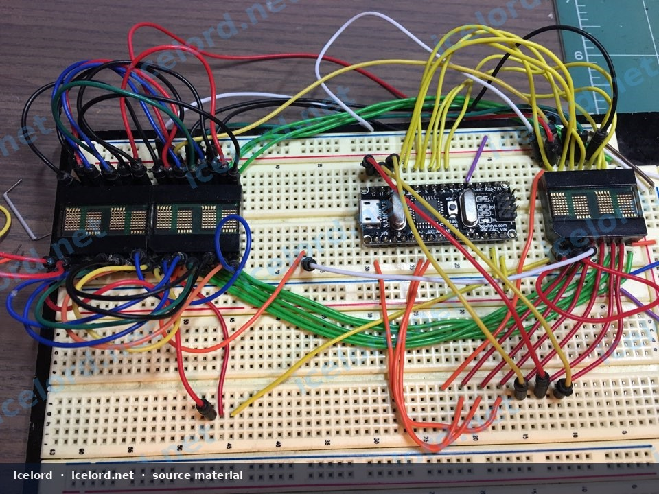
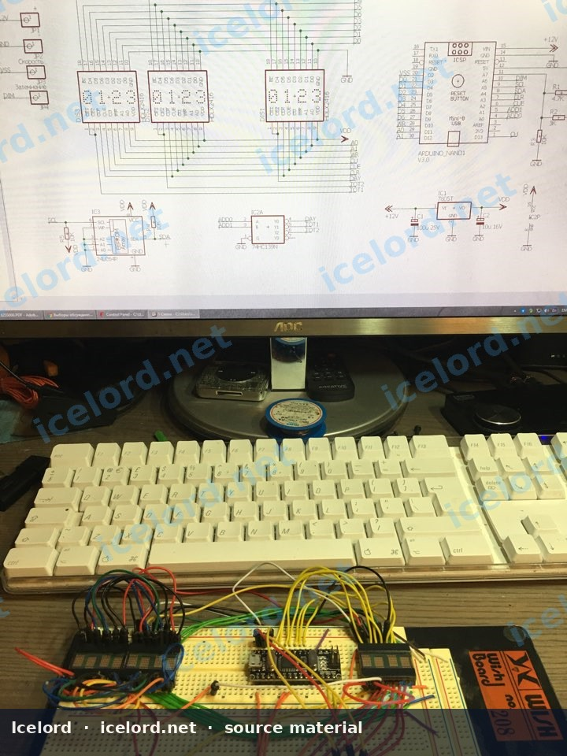
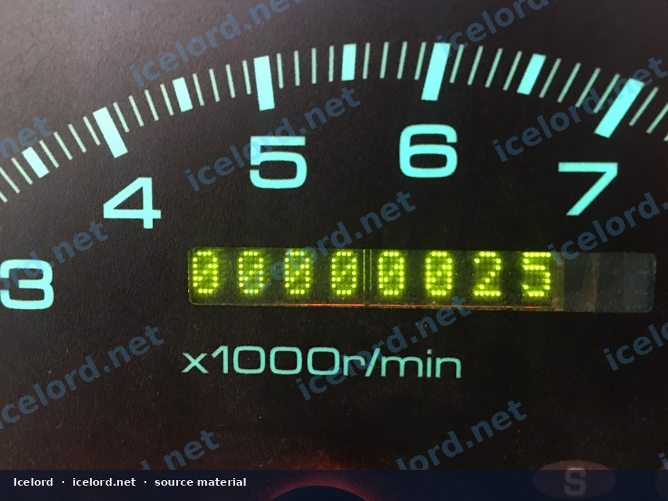
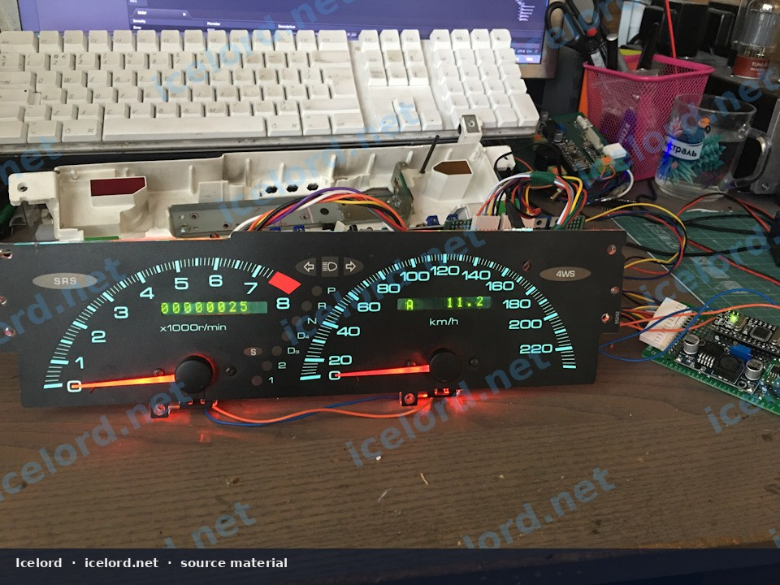
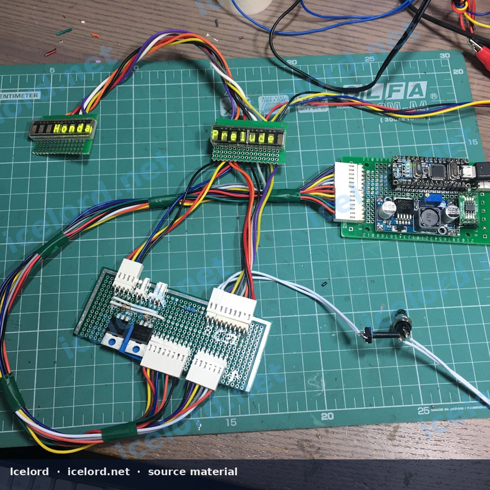

# Microcontroller-Based Digital Odometer for Honda Prelude (BB Chassis)

This article details the construction and integration of a custom digital odometer system designed to replace the original mechanical unit in a Honda Prelude (BB chassis). This solution offers enhanced functionality, precision, and programmability compared to the factory component, leveraging modern microcontroller technology with vintage-style displays.

```carousel

<!-- slide -->

<!-- slide -->

<!-- slide -->

<!-- slide -->


```

## Key Features

This custom digital odometer provides a range of advanced features:

*   **Precise Wheel Size Calibration:** Allows for accurate distance measurement adjustable to specific tire and wheel setups.
*   **Total Mileage Tracking:** Records the vehicle's cumulative distance traveled.
*   **Dual Trip Meters:** Two independent, resettable trip counters, each capable of tracking up to 9999.9 kilometers.
*   **Engine Hour Meter:** Monitors engine operating hours, derived from the engine's RPM signal, with a configurable normalization setting.
*   **Integrated Backlight Control:** Manages the LED backlighting for instrument cluster needles, including a warning flash function when user-defined parameters are exceeded.
*   **Electroluminescent Panel Control:** Provides control over aftermarket Indiglo-style gauge panel backlighting.
*   **Non-Volatile Data Storage:** All parameters and mileage data are securely stored in Ferroelectric RAM (FRAM), ensuring data persistence even without power.
*   **Vintage Display Aesthetics:** Utilizes classic HP Avago HCMS-2973 LED matrix displays for an authentic retro appearance.

## System Components

The core of this digital odometer system typically involves:

*   **Microcontroller Board:** An Arduino Nano (ATmega328) or similar compact microcontroller (e.g., ESP32, as seen in some prototypes) serves as the central processing unit.
*   **Display Units:** Multiple HP Avago HCMS-2973 LED matrix displays are used to show mileage and other data. These displays typically require a parallel interface.
*   **Non-Volatile Memory:** An I2C-compatible FRAM chip (e.g., 24C08P) is used for reliable storage of critical data.
*   **Voltage Regulator:** A 7805T linear voltage regulator converts the vehicle's 12V supply to a stable 5V for the microcontroller and displays.
*   **Driver Circuitry:** Additional components (resistors, transistors, etc.) are used to interface the microcontroller with the displays and other vehicle signals.

> [!NOTE]
> Due to the physical size of the custom electronics, the main control unit may need to be mounted externally to the instrument cluster housing, with only the display elements integrated into the cluster itself.

## Electrical Integration

Integrating the digital odometer requires tapping into several key signals within the vehicle's wiring harness, primarily from the instrument cluster or ECU connections.

### Required Inputs

*   **Vehicle Speed Sensor (VSS):** Provides the pulse signal necessary for calculating distance traveled. This is typically a 0-5V or 0-12V square wave signal.
*   **Ignition (Switched 12V):** Supplies power to the system when the vehicle is on.
*   **Dimmer (DIM):** An input signal (often a variable voltage or PWM) from the vehicle's dimmer circuit to adjust the brightness of the digital display.
*   **Engine RPM Signal:** Used for the engine hour meter function. This signal can often be sourced from the ECU or ignition system.
*   **User Button:** An input for cycling through trip meters, resetting values, and accessing settings.

> [!CAUTION]
> Always disconnect the vehicle's battery before performing any electrical work. Incorrect wiring can cause damage to the vehicle's electrical system or the custom odometer unit.

> [!IMPORTANT]
> Specific wire colors and pin locations for VSS, ignition, and dimmer signals must be confirmed using the Honda Factory Service Manual (FSM) for your exact Prelude model and year. Wiring diagrams vary between trims and production years.

### Arduino Nano Pinout Reference

This `wirelist` details typical connections for an Arduino Nano-based implementation. Pin assignments for display data and control lines may vary based on the specific display modules and firmware.

```wirelist
{
  "title": "Arduino Nano Odometer Connections",
  "variants": [
    {
      "id": "arduino-nano",
      "label": "Arduino Nano (ATmega328)",
      "groups": [
        {
          "label": "Vehicle Inputs",
          "rows": [
            { "pin": "D2", "signal": "VSS Input", "path": "Vehicle Speed Sensor", "note": "For distance calculation" },
            { "pin": "A0", "signal": "DIM Input", "path": "Instrument Cluster Dimmer", "note": "For display brightness adjustment" },
            { "pin": "A1", "signal": "Ignition Input", "path": "Switched 12V (via voltage divider)", "note": "System power enable" },
            { "pin": "D3", "signal": "User Button", "path": "Momentary Switch", "note": "For menu navigation/reset" }
          ]
        },
        {
          "label": "Memory (FRAM) Interface",
          "rows": [
            { "pin": "A4", "signal": "SDA (I2C Data)", "path": "FRAM IC (e.g., 24C08P)", "note": "Data line for non-volatile storage" },
            { "pin": "A5", "signal": "SCL (I2C Clock)", "path": "FRAM IC (e.g., 24C08P)", "note": "Clock line for non-volatile storage" }
          ]
        },
        {
          "label": "Power & Ground",
          "rows": [
            { "pin": "VIN", "signal": "+12V Input", "path": "Vehicle 12V (via 7805T)", "note": "Main power supply" },
            { "pin": "GND", "signal": "Ground", "path": "Vehicle Chassis Ground", "note": "Common ground connection" }
          ]
        },
        {
          "label": "Display & Control Outputs",
          "rows": [
            { "pin": "D0-D13", "signal": "Display Data/Control", "path": "HP Avago HCMS-2973 Displays", "note": "Parallel data and control lines (specific mapping depends on firmware)" },
            { "pin": "A0-A7", "signal": "Display Data/Control", "path": "HP Avago HCMS-2973 Displays", "note": "Parallel data and control lines (specific mapping depends on firmware)" }
          ]
        }
      ]
    }
  ]
}
```

## Firmware and Customization

The open-source nature of this project allows for extensive customization. The firmware, typically written in C++ for Arduino, can be modified to:

*   Adjust calibration factors for the VSS signal.
*   Change display modes or add new information.
*   Fine-tune engine hour calculation parameters.
*   Customize warning thresholds for backlight alerts.

Source code and schematics are often available on platforms like GitHub, enabling enthusiasts to build and modify the system to their specific needs. Refer to the project's repository for the most up-to-date information and code.

## Installation Considerations

Integrating a custom digital odometer requires careful planning and execution:

*   **Space Constraints:** The Prelude instrument cluster has limited internal space. An external enclosure for the main control board is often necessary.
*   **Wiring Harness:** Create a robust wiring harness with appropriate connectors to interface the custom unit with the vehicle's electrical system. Use automotive-grade wire and ensure proper insulation.
*   **Mounting:** Securely mount the display elements within the instrument cluster bezel and the external control unit in a discreet, protected location.
*   **Calibration:** After installation, perform initial calibration for wheel size and verify all functions (total mileage, trip meters, engine hours, backlight control).

> [!WARNING]
> Modifying the instrument cluster requires precision and care. Irreversible damage can occur if components are removed or cut improperly. Proceed with caution or seek professional assistance.

## Visual Reference
