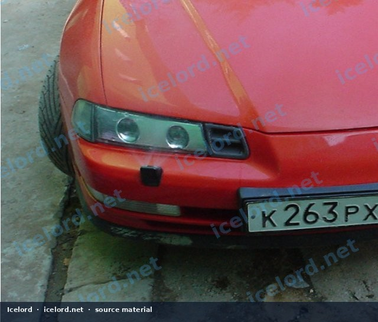

# Honda Prelude Headlamp Washer Retrofit

## Introduction
Headlamp washer systems improve visibility by cleaning dirt and debris from headlight lenses, a feature particularly beneficial in adverse weather conditions. While not standard on all Honda Prelude models, retrofitting this system is achievable by integrating OEM or aftermarket components. This guide outlines the general procedure for installing a headlamp washer system on a Honda Prelude (BB chassis).

*Image placeholder - replace with a publication-cleared photo (working.jpg).*

## Components Required
Successful integration of a headlamp washer system requires several key components. Sourcing original Honda parts designed for models that included this feature can simplify the process, though aftermarket alternatives may also be adapted.

### Mechanical Components
* **Washer Fluid Reservoir:** A reservoir designed to accommodate an additional pump for the headlamp washers. Some OEM reservoirs may have a pre-existing port for this purpose.
* **Headlamp Washer Pump:** A dedicated electric pump specifically for the headlamp washer system. This is separate from the windshield washer pump.
* **Headlamp Washer Nozzles:** Two nozzles, typically mounted in the front bumper, that spray fluid onto the headlamps.
* **Fluid Hoses and Connectors:** Appropriate diameter hosing to route fluid from the pump to the nozzles, along with necessary T-fittings, elbows, and clamps.
* **Check Valves:** Inline check valves are often used to prevent fluid drain-back and ensure immediate spray upon activation.

### Electrical Components
* **Electrical Wiring:** Automotive-grade wire of appropriate gauge for power, ground, and signal connections.
* **Relay:** A 12V automotive relay to control the high-current draw of the washer pump, activated by a low-current switch signal.
* **Fuse and Fuse Holder:** An inline fuse to protect the circuit, sized according to the pump's current draw. Consult the factory service manual (FSM) for recommended fuse ratings if using an OEM pump.
* **Control Switch:** An OEM headlamp washer switch (if available for the Prelude) or a suitable aftermarket momentary switch to activate the system.
* **Electrical Connectors:** Appropriate connectors for the pump, relay, and switch.

## Installation Procedure

### 1. Preparation and Safety
> [!WARNING]
> Always disconnect the negative terminal of the vehicle's 12V battery before performing any electrical work to prevent accidental short circuits or electrical shock.

* Gather all necessary tools and components.
* Review the Honda Prelude factory service manual (FSM) for specific diagrams related to bumper removal, washer system components, and electrical routing for your specific chassis code (BB).

### 2. Mechanical Installation

#### a. Bumper and Headlamp Removal
* Carefully remove the front bumper cover according to FSM procedures. This typically involves removing clips, screws, and potentially wheel well liners.
* Remove the headlamp assemblies if necessary to gain better access to the bumper mounting points or for routing fluid lines.

#### b. Washer Reservoir and Pump Installation
* Locate the existing windshield washer fluid reservoir. Determine if it has an unused port for an additional pump or if it needs to be replaced with a multi-pump reservoir.
* Install the headlamp washer pump into the designated port on the reservoir. Ensure a secure, leak-free fit.

#### c. Nozzle Installation and Fluid Line Routing
* Identify suitable locations on the front bumper for the headlamp washer nozzles. This may require cutting or drilling holes in the bumper cover. Measure precisely before cutting.
* Mount the headlamp washer nozzles securely in the bumper.
* Route the fluid hoses from the headlamp washer pump to each nozzle. Use T-fittings to split the line if using two nozzles from a single pump output.
* Secure all hoses with clamps and routing clips to prevent chafing or interference with moving parts. Install check valves close to the nozzles or pump as appropriate.

### 3. Electrical Installation
> [!IMPORTANT]
> Refer to the Honda Prelude factory service manual (FSM) for accurate wiring diagrams, wire colors, and connector pinouts specific to your vehicle's model year. Do not guess wire functions or colors.

#### a. Wiring the Washer Pump
* Connect the positive (+) terminal of the headlamp washer pump to the output side of your relay.
* Connect the negative (-) terminal of the pump to a reliable chassis ground point.

#### b. Integrating the Control Switch
* Install the chosen control switch in a convenient location within the cabin. If using an OEM switch, ensure it fits into an existing dash blank or panel.
* Wire the switch to control the relay's trigger signal. Typically, one side of the switch connects to a fused 12V ignition source, and the other side connects to the relay's trigger (coil) terminal.

#### c. Power Supply and Relay
* Mount the relay in a secure, dry location within the engine bay, away from excessive heat or moisture.
* Connect the relay's main power input (terminal 30) to a constant 12V fused power source. This fuse should be appropriately sized for the pump's current draw. Consult the FSM for fuse sizing or use a value recommended by the pump manufacturer.
* Connect the relay's ground terminal (terminal 85 or 86, depending on relay type) to a solid chassis ground.
* Connect the relay's trigger terminal (the other coil terminal) to the output of your control switch.

### 4. System Testing and Verification
* Once all mechanical and electrical connections are made, double-check all wiring for correct connections, proper insulation, and secure routing.
* Reconnect the negative battery terminal.
* Fill the washer fluid reservoir with appropriate fluid.
* Activate the headlamp washer switch. Verify that the pump operates, fluid sprays from the nozzles, and the headlamps are cleaned.
* Inspect all fluid connections for leaks.

## Important Considerations
* **Factory Service Manual:** Always consult the FSM for precise torque values, specific wire colors, and detailed component locations. This guide provides general steps, but the FSM is critical for accurate, vehicle-specific information.
* **Fluid Type:** Use only approved windshield washer fluid. Do not use plain water, especially in freezing temperatures.
* **Sealing:** Ensure all drilled holes in the bumper or chassis are properly sealed to prevent water ingress and corrosion.
* **Electrical Protection:** Always use fuses of the correct rating to protect the circuit and prevent potential electrical fires.

## Conclusion
Retrofitting a headlamp washer system can be a rewarding upgrade for your Honda Prelude, enhancing both safety and convenience. By carefully following these steps and consulting the factory service manual for specific details, you can successfully integrate this feature into your vehicle.
